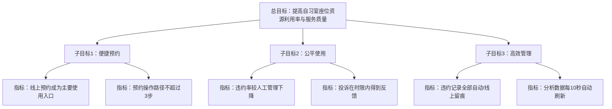
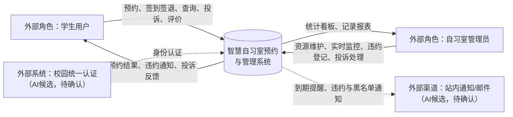
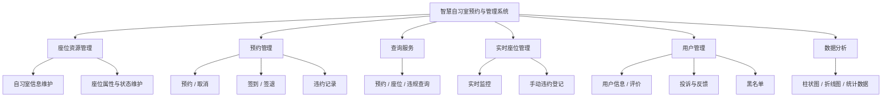
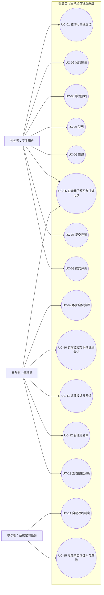
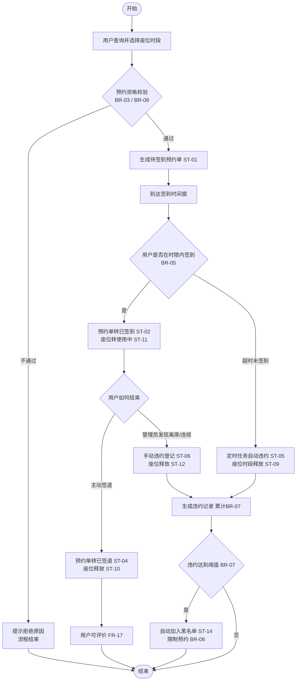
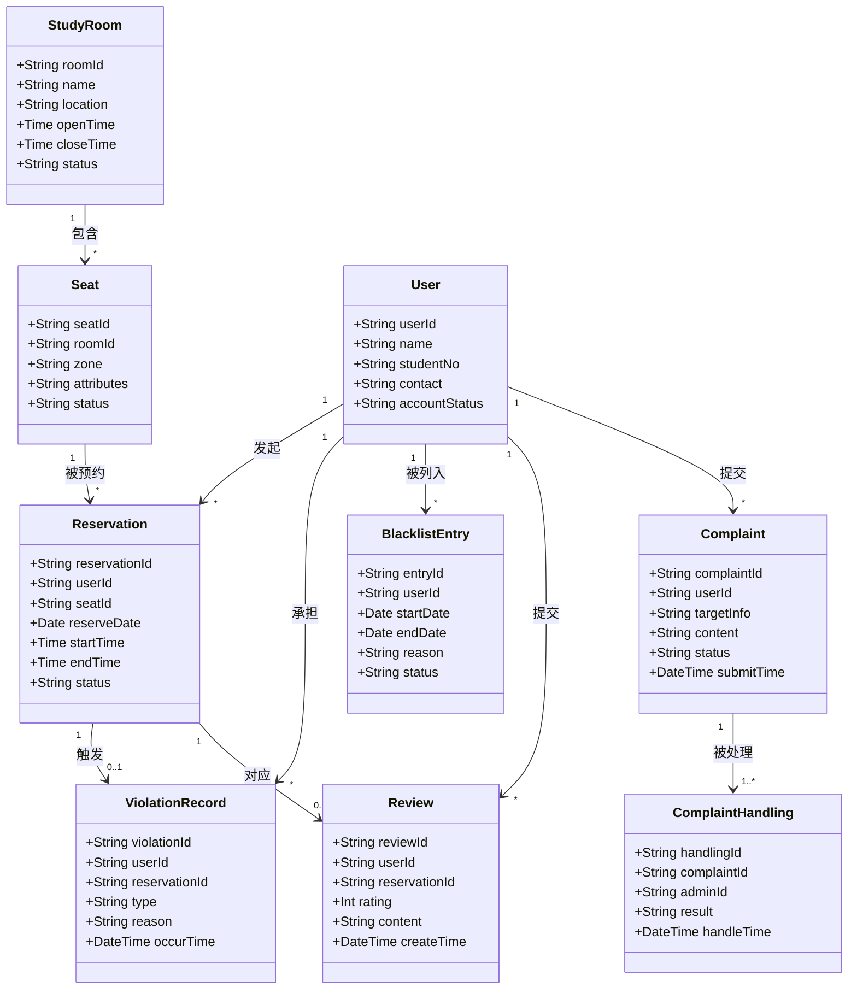
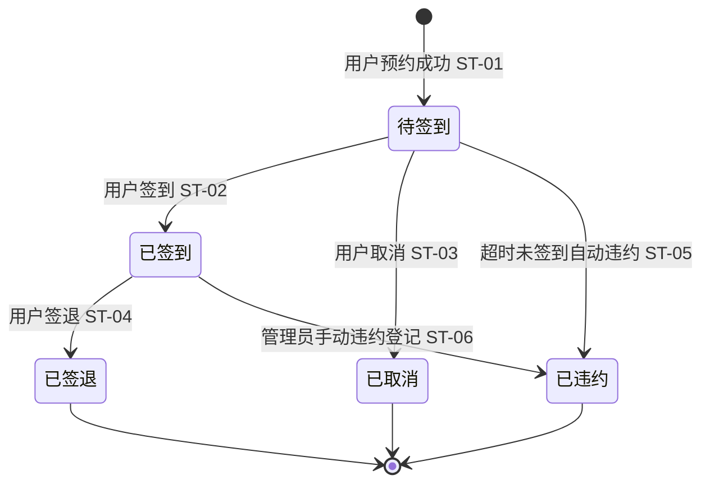
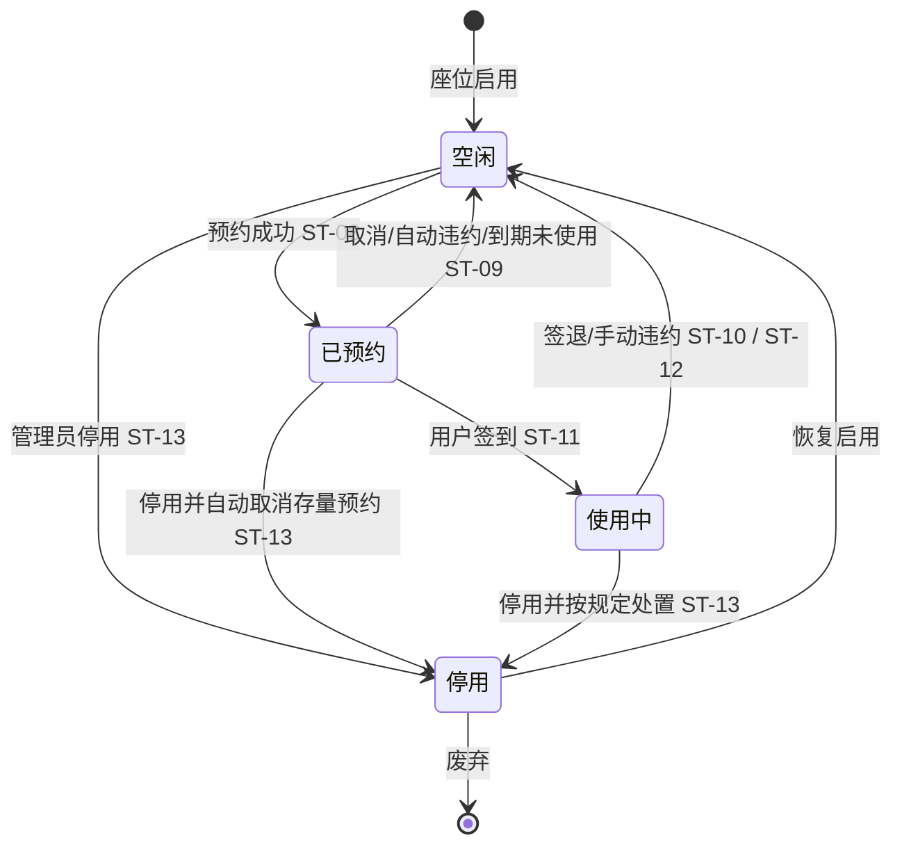
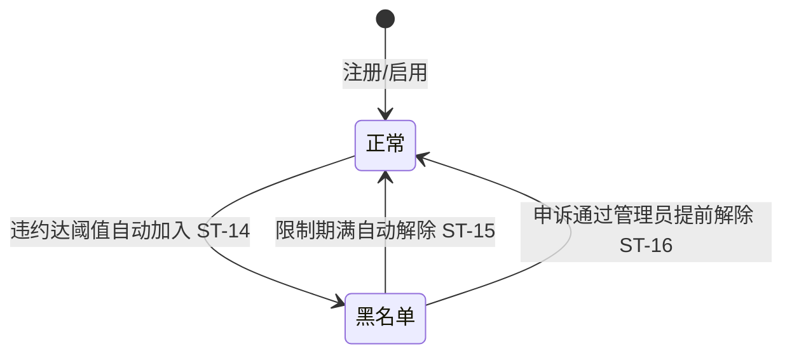

# 智慧自习室预约与管理系统需求规格说明书

| 文档项 | 内容 |
|---|---|
| 文档编号 | SRS-01 |
| 项目名称 | 智慧自习室预约与管理系统（熟悉业务系统项目） |
| 小组编号 | 【待填写】 |
| 成员名单 | 【待填写】 |
| 文档版本 | V1.0 |
| 编制日期 | 2026-10-15 |
| 状态 | 需求分析阶段稿 |

## 版本记录

| 版本 | 日期 | 修订内容 | 修订人 |
|---|---|---|---|
| V1.0 | 2026-10-15 | 初稿：业务目标、范围、角色权限、功能需求、业务规则、数据需求、状态模型、质量要求 | 【待填写】 |

---

## 1. 引言

### 1.1 编写目的

本文档描述"智慧自习室预约与管理系统"（以下简称"本系统"）的业务目标、系统范围、用户角色与权限、功能需求、业务规则、数据需求、核心对象状态模型以及质量要求，作为后续设计、开发、测试与验收的依据。

本文档的预期读者：本课程教师与助教、项目组成员、参与评审的其他小组。

### 1.2 项目背景

高校自习室座位资源紧张，普遍存在占座、爽约、资源分配不均等问题。本系统面向校园自习室场景，提供座位资源管理、线上预约、签到签退、违约治理、投诉处理、黑名单管理及数据分析能力，目标是提高座位资源利用率、降低爽约率、减轻人工管理负担。

任务来源：`task/熟悉业务系统项目 .md` 与《实践项目说明.pdf》第九节"熟悉业务系统项目"。

### 1.3 文档约定

#### 1.3.1 编号体系

| 编号前缀 | 含义 |
|---|---|
| FR-xx | 功能需求 |
| UC-xx | 用例 |
| BR-xx | 业务规则 |
| ST-xx | 状态转换 |
| NFR-xx | 质量属性需求（非功能需求） |

#### 1.3.2 规则来源性质标注

本文档沿用《学生需求分析与 AI 智能体使用验证报告》A.2 节口径，每条业务规则标注来源性质：

- **任务原文**：任务描述文件中明确给出的要求；
- **AI 候选**：任务未给定、由 AI 生成建议的数值或规则，**均为候选值，待教学模拟确认**；
- **分析推导**：依据业务逻辑推导得到的规则。

未完成确认的候选值在正式使用前保持候选状态，不因写入本文档而视为已确认。

### 1.4 术语与缩略语

| 术语 | 说明 |
|---|---|
| 座位 | 自习室内可被预约和使用的最小资源单元，具有唯一编号与属性 |
| 预约单 | 用户预约座位后生成的凭证记录，记录时段、座位、状态等信息 |
| 签到 | 用户在预约时段开始前后确认到场使用座位的操作 |
| 签退 | 用户结束使用座位、提前释放座位的操作 |
| 违约 | 用户未履行预约义务的记录，含自动违约与手动违约 |
| 自动违约 | 系统定时任务判定：超过签到时限未签到而记录的违约 |
| 手动违约 | 管理员对"已签到但实际离席/违规使用"行为登记的违约 |
| 黑名单 | 因违约达到阈值而被限制预约功能的用户名单 |
| 有效预约 | 状态为"待签到"或"已签到"的预约单 |

### 1.5 参考文献

1. `task/熟悉业务系统项目 .md`——项目任务描述；
2. 《实践项目说明.pdf》第九节——贯穿式课程项目设计说明；
3. 《学生需求分析与 AI 智能体使用验证报告.md》——文档编写与确认口径依据；
4. IEEE Std 830-1998——软件需求规格说明书推荐结构（参考）。

---

## 2. 总体描述

### 2.1 业务目标与成功指标

#### 2.1.1 目标树

图 GM-01：业务目标树（建模对象：系统业务目标；关联需求：全文）

#### 2.1.2 成功指标说明

| 指标 | 目标值 | 来源性质 |
|---|---|---|
| 预约操作路径 | 不超过 3 步 | AI 候选，待确认 |
| 违约率下降幅度 | 下降 30% 以上 | AI 候选，待确认（需以试运行基线为准） |
| 投诉反馈时限 | 3 个工作日内 | AI 候选，待确认（见 BR-11） |
| 数据分析刷新周期 | 10 秒 | 任务原文 |
| 违约与处理记录留痕率 | 100% | 分析推导 |

### 2.2 系统上下文

图 GM-02：系统上下文图（建模对象：系统边界与外部交互；关联需求：全文）

### 2.3 系统范围

#### 2.3.1 范围内功能

对应任务原文 7 类核心功能：

1. 自习室（座位）资源与属性管理；
2. 预约管理（用户、管理员两类视角）；
3. 预约、取消预约、签到、签退与自动违约记录；
4. 相关查询：预约查询、座位查询、违规记录查询等；
5. 管理员实时座位管理（含手动违约登记）、座位使用与预约记录；
6. 用户管理：用户信息管理（评价管理）、用户投诉管理、投诉反馈信息、黑名单管理；
7. 数据分析：柱状图分析、折线图分析、统计数据，每 10 秒自动刷新。

#### 2.3.2 范围外事项

以下内容不在本期范围内（来源：AI 候选，用于界定边界，待教学模拟确认）：

- 门禁、闸机等硬件联动控制；
- 座位使用收费与结算；
- 跨校区多校园统一平台；
- 基于 AI 的个性化座位推荐；
- 移动端原生 App（仅要求浏览器可访问，见 2.4 节约束）。

### 2.4 运行环境与约束

| 约束项 | 内容 | 来源性质 |
|---|---|---|
| 访问方式 | 通过浏览器访问，适配桌面端与移动端浏览器 | AI 候选，待确认 |
| 数据刷新 | 数据分析页面每 10 秒自动刷新 | 任务原文 |
| 部署环境 | 部署于校园网内服务器 | 分析推导 |
| 时间一致性 | 违约判定依赖服务器统一时间 | 分析推导 |

### 2.5 假设与依赖

- 假设每个座位在同一时段最多被一个有效预约占用（分析推导，BR-03 支撑）；
- 假设用户以真实学籍身份注册（若接入校园统一认证则依赖其可用性，AI 候选，待确认）；
- 依赖：自动违约判定依赖系统定时任务的稳定运行。

---

## 3. 角色与权限

### 3.1 角色定义

| 角色 | 说明 | 主要职责 |
|---|---|---|
| 学生用户 | 使用自习室座位的在校学生 | 预约、取消、签到、签退、查询、评价、投诉 |
| 自习室管理员 | 负责自习室日常运营的人员 | 资源维护、实时监控、手动违约登记、投诉处理、黑名单管理、查看数据分析 |
| 系统定时任务 | 非人类执行者，由系统调度 | 自动违约判定、黑名单自动加入、黑名单期满自动解除 |

### 3.2 权限矩阵

操作 × 角色权限对照（√ 允许，× 拒绝）：

| 操作 | 学生用户 | 管理员 | 系统定时任务 | 关联需求 |
|---|---|---|---|---|
| 查询座位与可用时段 | √ | √ | — | FR-05 |
| 提交预约 | √（黑名单期内 ×） | ×（不代约） | — | FR-06、BR-08 |
| 取消本人预约 | √ | × | — | FR-07、BR-04 |
| 签到 / 签退本人预约 | √ | × | — | FR-08、FR-09 |
| 查询本人预约与违规记录 | √（仅本人） | √（可查全员） | — | FR-11、FR-12 |
| 维护自习室 / 座位信息 | × | √ | — | FR-01、FR-02 |
| 停用座位并处理存量预约 | × | √ | 自动取消受影响预约（通知） | FR-04、BR-14 |
| 查看实时座位状态 | × | √ | — | FR-14 |
| 手动违约登记 | × | √ | — | FR-15、BR-13 |
| 提交投诉 | √ | × | — | FR-18 |
| 处理投诉并反馈 | × | √ | — | FR-18、FR-19 |
| 提交使用评价 | √ | × | — | FR-17 |
| 查看 / 删除违规评价 | × | √ | — | FR-17 |
| 加入 / 解除黑名单 | × | 仅解除为手动；加入由系统判定 | 自动加入（BR-07） | FR-20 |
| 查看数据分析看板 | × | √ | — | FR-21～FR-23 |

权限不足时系统应明确拒绝并提示原因，不改变任何业务数据与状态。

---

## 4. 功能需求

### 4.0 功能模块总览

图 GM-03：功能模块图（建模对象：系统功能结构；关联需求：FR-01～FR-23）

### 4.1 座位资源管理

| 编号 | 需求名称 | 需求描述 | 优先级 | 关联规则 |
|---|---|---|---|---|
| FR-01 | 自习室信息维护 | 管理员可录入、修改自习室基本信息：名称、位置、开放时间段、容纳座位数 | 高 | — |
| FR-02 | 座位属性管理 | 管理员可维护座位编号、所属自习室、区域、属性标签（如靠窗、有电源），并设置启用/停用 | 高 | — |
| FR-03 | 座位状态实时查询 | 系统按时间维度提供各座位状态（可预约/已预约/使用中/停用） | 高 | 7.2 节状态模型 |
| FR-04 | 座位停用与恢复 | 管理员停用座位时，系统自动取消该座位未来时段的未开始预约，并向受影响用户发送通知 | 高 | BR-14 |

### 4.2 预约管理

用户故事：

- 作为学生用户，我希望按日期和时段查询可用座位，以便选择合适的自习位置；
- 作为学生用户，我希望在线预约座位并在到期前取消，以免误约无法释放资源；
- 作为学生用户，我希望到达后快速签到、离开时签退，避免被误记违约；
- 作为管理员，我希望系统自动记录违约，减少人工巡查成本。

#### FR-05 查询可预约座位

- 输入：日期、时段、自习室/区域、属性标签（可选筛选）；
- 处理：按 BR-02 的可预约时间窗过滤，展示座位及其可约时段；
- 输出：可预约座位列表与状态标识；
- 优先级：高；关联规则：BR-02。

#### FR-06 提交预约

- 输入：座位、日期、时段；
- 处理：校验用户是否处于黑名单（BR-08）、是否与本人已有有效预约时段冲突（BR-03）、座位该时段是否可约；通过后生成状态为"待签到"的预约单；
- 输出：预约成功凭证（预约单号、时段、座位信息）；
- 异常：黑名单、时段冲突、已被他人预约时拒绝，提示原因；
- 优先级：高；关联规则：BR-02、BR-03、BR-08；状态转换：ST-01。

#### FR-07 取消预约

- 输入：预约单号；
- 处理：校验属于本人且处于"待签到"状态、是否满足取消时限（BR-04）；通过后预约单置为"已取消"，座位时段释放；
- 输出：取消成功通知；
- 异常：超过取消时限或状态不允许时拒绝并说明（对应 ST-03 拒绝分支）；
- 优先级：高；关联规则：BR-04。

#### FR-08 签到

- 输入：预约单号（页面点击或扫码触发）；
- 处理：校验为本人预约、状态为"待签到"、处于允许签到时间窗（BR-05 前半段）；通过后预约单转为"已签到"，座位转为"使用中"；
- 输出：签到成功确认；
- 异常：不在签到时间窗内拒绝；
- 优先级：高；关联规则：BR-05；状态转换：ST-02。

#### FR-09 签退

- 输入：预约单号；
- 处理：校验为本人预约且状态为"已签到"；通过后预约单转为"已签退"，座位立即释放为可预约（BR-09）；
- 输出：签退成功确认；
- 优先级：高；关联规则：BR-09；状态转换：ST-04。

#### FR-10 违约记录

- 自动违约：系统定时任务在超过 BR-05 签到时限仍未签到时，将预约单置为"已违约"并生成违约记录（ST-05）；
- 手动违约：管理员按 FR-15 登记后生成违约记录（ST-06）；
- 违约记录内容：用户、预约单、违约类型、发生时间、判定依据（自动/手动及原因）；
- 优先级：高；关联规则：BR-05、BR-06、BR-13。

### 4.3 查询服务

| 编号 | 需求名称 | 需求描述 | 优先级 |
|---|---|---|---|
| FR-11 | 我的预约查询 | 用户查询本人预约单列表及状态（含历史） | 高 |
| FR-12 | 违规记录查询 | 用户查询本人违约记录（时间、原因、类型）；管理员可按用户/时间段检索全部记录 | 高 |
| FR-13 | 座位使用与预约记录查询 | 管理员查询某座位/某时段的使用与预约记录，用于运营追溯 | 中 |

### 4.4 实时座位管理

| 编号 | 需求名称 | 需求描述 | 优先级 | 关联规则 |
|---|---|---|---|---|
| FR-14 | 实时座位监控 | 管理员看板实时展示各自习室座位占用情况（空闲/已预约/使用中/停用），每 10 秒自动刷新 | 高 | BR-10 |
| FR-15 | 手动违约登记 | 管理员对"已签到"但实际离席或违规使用的用户登记违约，须填写原因；登记后该预约单转为"已违约"、座位释放 | 高 | BR-06、BR-13 |

### 4.5 用户管理

| 编号 | 需求名称 | 需求描述 | 优先级 | 关联规则 |
|---|---|---|---|---|
| FR-16 | 用户信息管理 | 用户维护本人基本信息；管理员可查询用户账户信息与状态 | 高 | — |
| FR-17 | 评价管理 | 用户在预约完成后对本次使用进行评价（候选：完成签退后可评，每人每单 1 条，见 BR-12）；管理员可查看并删除违规评价 | 中 | BR-12 |
| FR-18 | 投诉提交与处理 | 用户提交投诉（对象可为座位设施、他人占座行为、违约判定等）；管理员受理、处理并填写处理结果；投诉状态流转：待处理→处理中→已反馈→已关闭 | 高 | BR-11 |
| FR-19 | 投诉反馈信息 | 投诉处理完成后，系统向投诉人推送处理结果；投诉人可查看本人投诉及处理状态 | 高 | BR-11 |
| FR-20 | 黑名单管理 | 系统按 BR-07 自动将达违约阈值的用户加入黑名单并限制预约（BR-08）；管理员可查看黑名单、处理申诉、提前解除；期满自动解除 | 高 | BR-07、BR-08 |

### 4.6 数据分析

| 编号 | 需求名称 | 需求描述 | 优先级 | 关联规则 |
|---|---|---|---|---|
| FR-21 | 柱状图分析 | 按自习室统计使用率对比、按时段统计使用量分布，以柱状图展示 | 中 | BR-10 |
| FR-22 | 折线图分析 | 按日/周/月展示预约量、违约率、投诉量变化趋势，以折线图展示 | 中 | BR-10 |
| FR-23 | 统计数据自动刷新 | 分析看板的统计数据每 10 秒自动刷新，无需人工刷新页面 | 中 | BR-10（任务原文） |

### 4.7 用例模型

#### 4.7.1 用例图

图 GM-04：系统用例图（Mermaid 表达 UML 用例语义；建模对象：系统级用例；关联需求：FR-01～FR-23）

#### 4.7.2 关键用例描述

##### UC-02 预约座位

| 项目 | 内容 |
|---|---|
| 参与者 | 学生用户 |
| 前置条件 | 用户已登录；账户状态为"正常"（不在黑名单） |
| 主流程 | 1. 用户选择日期与时段，查询可预约座位（UC-01）；2. 系统按 BR-02 过滤可约范围；3. 用户选定座位提交预约；4. 系统校验黑名单（BR-08）、时段冲突（BR-03）、座位可用性；5. 生成"待签到"预约单并提示成功（ST-01） |
| 异常流程 | 3a. 处于黑名单：拒绝并提示限制截止时间（状态保持，不生成预约单）；3b. 与本人有效预约时段冲突：拒绝并提示冲突单（BR-03）；3c. 座位该时段刚被他人约走：拒绝并提示重新选择 |
| 后置条件 | 成功：产生一条"待签到"预约单，座位该时段不可再被他人预约；失败：数据与状态不变 |
| 关联规则与转换 | BR-02、BR-03、BR-08、ST-01 |

##### UC-04 签到

| 项目 | 内容 |
|---|---|
| 参与者 | 学生用户 |
| 前置条件 | 存在本人"待签到"预约单，当前时间处于 BR-05 允许的签到时间窗 |
| 主流程 | 1. 用户打开签到入口；2. 系统校验预约单归属与状态、签到时间窗；3. 预约单转为"已签到"（ST-02），座位转为"使用中" |
| 异常流程 | 2a. 不在签到时间窗：拒绝并提示可签到时间（状态保持"待签到"） |
| 后置条件 | 成功：预约单"已签到"、座位"使用中"；失败：状态保持 |
| 关联规则与转换 | BR-05、ST-02、ST-11 |

##### UC-10 实时监控与手动违约登记

| 项目 | 内容 |
|---|---|
| 参与者 | 管理员 |
| 前置条件 | 管理员已登录并具有座位管理权限 |
| 主流程 | 1. 管理员打开实时座位看板（10 秒自动刷新，BR-10）；2. 对"使用中"但实际无人的座位发起手动违约登记；3. 填写违约原因提交；4. 系统将对应预约单置为"已违约"（ST-06），生成违约记录，座位释放为可预约 |
| 异常流程 | 2a. 目标预约单不处于"已签到"状态：拒绝登记（BR-13，状态保持） |
| 后置条件 | 成功：违约记录产生、预约单"已违约"、座位释放；失败：状态保持 |
| 关联规则与转换 | BR-06、BR-10、BR-13、ST-06 |

其余用例（UC-01、UC-03、UC-05～UC-09、UC-11～UC-15）与 FR-05、FR-07、FR-09、FR-11～FR-23 一一对应，主流程与异常流程要点已在对应功能需求中描述，场景推演详见后续《A. 需求分析质量验证报告》A.5 节（编号沿用本文档）。

#### 4.7.3 核心活动图

图 GM-05：预约-签到-签退主流程活动图（建模对象：核心业务流程；关联需求：FR-06～FR-10；关联用例：UC-02、UC-04、UC-05、UC-10、UC-14）

---

## 5. 业务规则

| 编号 | 规则名称 | 规则内容 | 来源性质 | 确认状态 |
|---|---|---|---|---|
| BR-01 | 预约时段粒度 | 预约按 1 小时为最小单位选择时段 | AI 候选 | 待确认 |
| BR-02 | 可预约时间窗 | 仅可预约当日及未来 3 天内的时段 | AI 候选 | 待确认 |
| BR-03 | 有效预约上限 | 同一用户同一时段仅允许 1 个有效预约；预约时段不得与本人有效预约重叠 | 分析推导 | 待确认 |
| BR-04 | 取消时限 | 距预约开始前 15 分钟及以上可取消；不足 15 分钟不可取消 | AI 候选 | 待确认 |
| BR-05 | 签到时限 | 允许在预约开始前 10 分钟至开始后 15 分钟内签到；开始后 15 分钟未签到即触发自动违约 | AI 候选 | 待确认 |
| BR-06 | 违约计数 | 自动违约与手动违约均计 1 次违约，统一累计 | 分析推导 | 待确认 |
| BR-07 | 黑名单阈值 | 30 天内累计违约达 3 次自动加入黑名单，限制期 7 天 | AI 候选 | 待确认 |
| BR-08 | 黑名单限制 | 黑名单期内禁止提交新预约；已有未来预约如何处理见 BR-14 类似逻辑（候选：保留，由团队确认） | AI 候选 | 待确认 |
| BR-09 | 签退即释放 | 签退后座位立即恢复为对应时段可预约 | 分析推导 | 待确认 |
| BR-10 | 数据自动刷新 | 数据分析页面每 10 秒自动刷新 | **任务原文** | 已给定 |
| BR-11 | 投诉处理时限 | 投诉应在 3 个工作日内完成处理并反馈 | AI 候选 | 待确认 |
| BR-12 | 评价条件 | 完成签退后可对本次使用评价，每人每预约单限 1 条 | AI 候选 | 待确认 |
| BR-13 | 手动违约条件 | 仅可对处于"已签到"状态的预约单登记手动违约，且必须填写原因 | 分析推导 | 待确认 |
| BR-14 | 停用联动处理 | 座位停用时自动取消其未来未开始时段的预约，并向受影响用户发送通知 | 分析推导 | 待确认 |

> 上表中除 BR-10 外均为候选规则，待通过教学模拟确认（小组成员扮演业务方/教师）后方可作为本项目设定使用，确认记录将归档于 A.2 节。

---

## 6. 数据需求

### 6.1 领域类图

图 GM-06：领域类图（建模对象：核心业务实体；关联需求：FR-01～FR-23；与数据字典一致）

说明：管理员为 User 的一个角色（以权限区分），不单独建类；统计数据（FR-21～FR-23）由预约、违约、投诉等记录派生计算，不作为独立持久化实体。

### 6.2 数据字典（核心实体）

#### 6.2.1 预约单 Reservation

| 字段 | 类型 | 说明 | 约束 |
|---|---|---|---|
| reservationId | 字符串 | 预约单号，唯一标识 | 主键 |
| userId | 字符串 | 预约用户 | 外键→User |
| seatId | 字符串 | 座位 | 外键→Seat |
| reserveDate | 日期 | 使用日期 | 不早于当日（BR-02） |
| startTime / endTime | 时间 | 时段 | 粒度满足 BR-01 |
| status | 枚举 | 待签到/已签到/已签退/已取消/已违约 | 见 7.1 状态模型 |

#### 6.2.2 座位 Seat

| 字段 | 类型 | 说明 | 约束 |
|---|---|---|---|
| seatId | 字符串 | 座位编号，唯一 | 主键 |
| roomId | 字符串 | 所属自习室 | 外键→StudyRoom |
| zone | 字符串 | 区域 | 可选 |
| attributes | 字符串列表 | 属性标签（靠窗/有电源等） | 可选 |
| status | 枚举 | 空闲/已预约/使用中/停用 | 见 7.2 状态模型 |

#### 6.2.3 违约记录 ViolationRecord

| 字段 | 类型 | 说明 | 约束 |
|---|---|---|---|
| violationId | 字符串 | 违约编号，唯一 | 主键 |
| userId | 字符串 | 违约用户 | 外键→User |
| reservationId | 字符串 | 关联预约单 | 外键→Reservation |
| type | 枚举 | 自动违约/手动违约 | BR-05、BR-13 |
| reason | 字符串 | 违约原因（手动违约必填） | BR-13 |
| occurTime | 日期时间 | 判定时间 | 由服务器时间生成 |

#### 6.2.4 黑名单记录 BlacklistEntry

| 字段 | 类型 | 说明 | 约束 |
|---|---|---|---|
| entryId | 字符串 | 记录编号，唯一 | 主键 |
| userId | 字符串 | 用户 | 外键→User |
| startDate / endDate | 日期 | 限制起止 | 由 BR-07 计算 |
| reason | 字符串 | 列入原因（含违约次数统计） | 系统生成 |
| status | 枚举 | 生效中/已解除/到期解除 | 见 7.3 |

#### 6.2.5 投诉 Complaint 与处理记录 ComplaintHandling

| 字段 | 类型 | 说明 | 约束 |
|---|---|---|---|
| complaintId | 字符串 | 投诉编号，唯一 | 主键 |
| userId | 字符串 | 投诉人 | 外键→User |
| targetInfo | 字符串 | 投诉对象（座位/行为/判定结果等） | — |
| content | 字符串 | 投诉内容 | 必填 |
| status | 枚举 | 待处理/处理中/已反馈/已关闭 | BR-11 时限约束 |
| result（处理记录） | 字符串 | 处理结果与反馈内容 | 处理人必填 |

#### 6.2.6 用户 User / 评价 Review

| 字段 | 类型 | 说明 | 约束 |
|---|---|---|---|
| userId | 字符串 | 用户标识，唯一 | 主键 |
| studentNo | 字符串 | 学号 | 唯一 |
| accountStatus | 枚举 | 正常/黑名单 | 见 7.3 |
| role | 枚举 | 学生用户/管理员 | 权限矩阵依据 |
| rating（评价） | 整数 | 评分 1～5 | BR-12 条件限制 |

---

## 7. 状态模型

### 7.1 预约单状态模型

图 GM-07：预约单状态图（建模对象：预约单；关联需求：FR-06～FR-10；关联规则：BR-03～BR-09、BR-13）

状态转换说明表（与上图、场景走查共用同一编号）：

| 转换编号 | 当前状态 | 触发事件 | 执行角色 | 条件或判定依据 | 目标状态及业务结果 | 失败或拒绝时处理 |
|---|---|---|---|---|---|---|
| ST-01 | （无） | 提交预约 | 学生用户 | 非黑名单（BR-08）；无时段冲突（BR-03）；座位时段可约；在可预约时间窗内（BR-02） | 转为"待签到"；生成有效预约单；座位对应时段锁定（座位转"已预约" ST-08） | 提示拒绝原因；不生成预约单；座位时段与用户预约数据不变 |
| ST-02 | 待签到 | 签到 | 学生用户 | 本人预约；处于签到时间窗（BR-05 前段） | 转为"已签到"；座位转"使用中"（ST-11） | 不在时间窗时提示可签到时间；预约单保持"待签到" |
| ST-03 | 待签到 | 取消预约 | 学生用户 | 本人预约；距开始 ≥ 15 分钟（BR-04） | 转为"已取消"；座位时段释放 | 不足时限时拒绝取消并提示；预约单保持"待签到" |
| ST-04 | 已签到 | 签退 | 学生用户 | 本人预约 | 转为"已签退"；座位立即释放（BR-09、ST-10）；可触发评价（BR-12） | 状态异常时提示；状态保持 |
| ST-05 | 待签到 | 定时任务扫描 | 系统定时任务 | 超过开始时间 15 分钟仍未签到（BR-05 后段） | 转为"已违约"；生成自动违约记录；违约计数 +1（BR-06） | 定时任务异常时记录日志并重试；不影响用户数据 |
| ST-06 | 已签到 | 手动违约登记 | 管理员 | 预约单处于"已签到"；管理员具权限；填写原因（BR-13） | 转为"已违约"；生成手动违约记录；座位释放（ST-12） | 状态不符或无权限时拒绝；预约单保持"已签到"；不产生违约记录 |
| ST-07 | 已签退/已违约 | （终态归档） | 系统 | — | 记录归档，参与违约计数与统计 | — |

### 7.2 座位状态模型

图 GM-08：座位状态图（建模对象：座位（时段视角）；关联需求：FR-02～FR-04、FR-06～FR-10；关联规则：BR-09、BR-14）

| 转换编号 | 当前状态 | 触发事件 | 执行角色 | 条件或判定依据 | 目标状态及业务结果 | 失败或拒绝时处理 |
|---|---|---|---|---|---|---|
| ST-08 | 空闲 | 预约成功 | 学生用户 | 同 ST-01 条件 | 该时段转"已预约" | 拒绝时保持"空闲" |
| ST-09 | 已预约 | 取消 / 自动违约 | 学生用户 / 系统 | 同 ST-03 / ST-05 | 时段释放回"空闲" | 不满足条件时保持"已预约" |
| ST-10 | 使用中 | 签退 | 学生用户 | 同 ST-04 | 立即释放为"空闲"（BR-09） | 异常时保持"使用中" |
| ST-11 | 已预约 | 签到 | 学生用户 | 同 ST-02 | 转"使用中" | 拒绝时保持"已预约" |
| ST-12 | 使用中 | 手动违约登记 | 管理员 | 同 ST-06 | 释放为"空闲"，生成违约记录 | 拒绝时保持"使用中" |
| ST-13 | 空闲/已预约/使用中 | 停用座位 | 管理员 | 管理员权限 | 转"停用"；自动取消未来预约并通知（BR-14） | 无权限时拒绝；状态保持 |

> 说明：预约单状态转换编号（ST-01～ST-07）与座位状态转换编号（ST-08～ST-13）在同一编号空间中全局唯一，便于场景走查与 A 报告引用。

### 7.3 用户账户状态模型

图 GM-09：用户账户状态图（建模对象：用户账户（黑名单视角）；关联需求：FR-06、FR-20；关联规则：BR-07、BR-08）

| 转换编号 | 当前状态 | 触发事件 | 执行角色 | 条件或判定依据 | 目标状态及业务结果 | 失败或拒绝时处理 |
|---|---|---|---|---|---|---|
| ST-14 | 正常 | 违约计数触发 | 系统定时任务 | 30 天内违约累计达 3 次（BR-07） | 转"黑名单"；限制期 7 天内禁止预约（BR-08） | 计数不足时不触发；账户保持"正常" |
| ST-15 | 黑名单 | 限制期满 | 系统定时任务 | 到达 endDate | 转"正常"；恢复预约功能；记录到期解除 | — |
| ST-16 | 黑名单 | 申诉通过 | 管理员 | 申诉理由成立（人工判定） | 转"正常"；记录提前解除与理由 | 申诉被驳回：保持"黑名单"，反馈驳回理由 |

---

## 8. 质量要求（非功能需求）

| 编号 | 类别 | 要求 | 来源性质 |
|---|---|---|---|
| NFR-01 | 性能 | 普通查询页面响应时间 ≤ 2 秒（常规网络条件下） | AI 候选，待确认 |
| NFR-02 | 性能 | 数据分析看板每 10 秒自动刷新且刷新过程无明显卡顿 | **任务原文** |
| NFR-03 | 性能 | 支持不低于 500 名用户并发在线使用（考试周高峰） | AI 候选，待确认 |
| NFR-04 | 可靠性 | 系统周可用性 ≥ 99%；自动违约定时任务失败须告警并支持补跑 | AI 候选，待确认 |
| NFR-05 | 安全性 | 用户仅能访问本人数据；操作须经权限校验（见 3.2 权限矩阵）；越权请求一律拒绝并记录日志 | 分析推导 |
| NFR-06 | 安全性 | 违约登记、投诉处理、黑名单加入/解除等敏感操作须留痕（操作人、时间、原因） | 分析推导 |
| NFR-07 | 可用性 | 学生高频操作（查询、预约、签到）操作路径不超过 3 步 | AI 候选，待确认 |
| NFR-08 | 可维护性 | 自习室、座位、属性标签等基础数据支持管理员在线维护，无需修改代码 | 分析推导 |
| NFR-09 | 可审计性 | 预约、违约、投诉、黑名单全流程记录可追溯，支持按用户/时间段导出查询（FR-11～FR-13） | 分析推导 |
| NFR-10 | 数据一致性 | 座位时段占用与预约单状态保持一致；同一座位同一时段至多 1 个有效预约（BR-03） | 分析推导 |

---

## 9. 附录

### 附录 A：待确认候选规则汇总

以下规则数值均为候选值，需通过教学模拟确认后定稿（对应《A. 需求分析质量验证报告》A.2 节确认表，编号沿用）：

| 规则编号 | 候选内容 | 拟确认方式 |
|---|---|---|
| BR-01 | 时段粒度 1 小时 | 小组模拟讨论 |
| BR-02 | 可约当日及未来 3 天 | 小组模拟讨论 |
| BR-03 | 同一时段 1 个有效预约 | 团队复核 |
| BR-04 | 提前 15 分钟可取消 | 小组模拟讨论 |
| BR-05 | 开始后 15 分钟未签到违约 | 小组模拟讨论 |
| BR-06 | 违约统一计数 | 团队复核 |
| BR-07 | 30 天 3 次违约入黑名单 7 天 | 小组模拟讨论（扮演业务方） |
| BR-08 | 黑名单期内禁止预约 | 团队复核 |
| BR-11 | 投诉 3 个工作日内反馈 | 小组模拟讨论 |
| BR-12 | 签退后可评价、每单 1 条 | 小组模拟讨论 |
| BR-14 | 停用自动取消存量预约 | 团队复核 |

### 附录 B：图模型索引

| 图编号 | 图名称 | 建模对象 | 所在章节 |
|---|---|---|---|
| GM-01 | 业务目标树 | 业务目标层级 | 2.1.1 |
| GM-02 | 系统上下文图 | 系统边界与外部交互 | 2.2 |
| GM-03 | 功能模块图 | 功能结构 | 4.0 |
| GM-04 | 用例图 | 系统级用例 | 4.7.1 |
| GM-05 | 活动图 | 预约-签到-签退核心流程 | 4.7.3 |
| GM-06 | 领域类图 | 核心业务实体 | 6.1 |
| GM-07 | 状态图 | 预约单 | 7.1 |
| GM-08 | 状态图 | 座位 | 7.2 |
| GM-09 | 状态图 | 用户账户（黑名单视角） | 7.3 |

### 附录 C：与其他交付文档的关系

- 本文档的 FR/UC/BR/ST/NFR 编号将被《A. 需求分析质量验证报告》直接引用（A.2 规则确认表引用 BR，A.4 状态转换表引用 ST，A.5 场景走查引用 SC 并关联 BR/ST）；
- 候选规则的确认状态以 A.2 节确认记录为准，本文档不代替确认过程。
