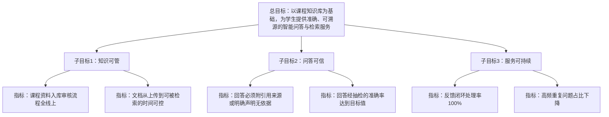
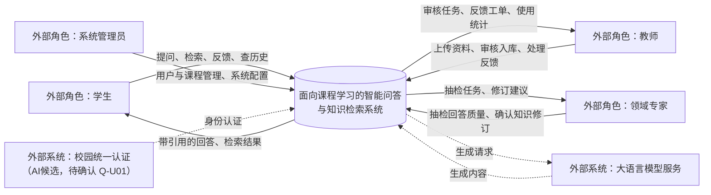
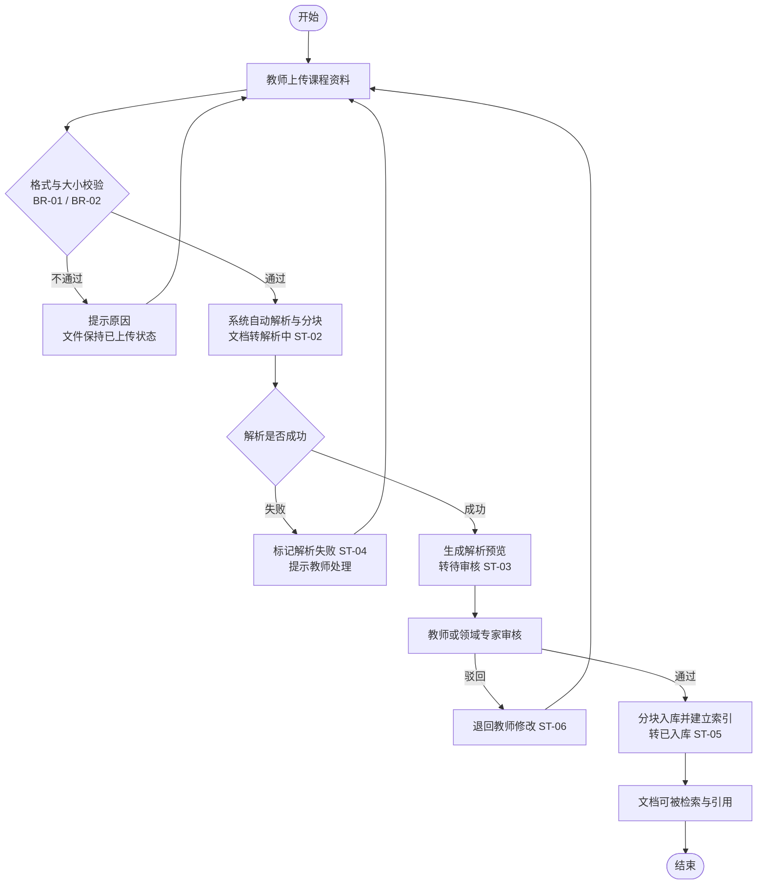
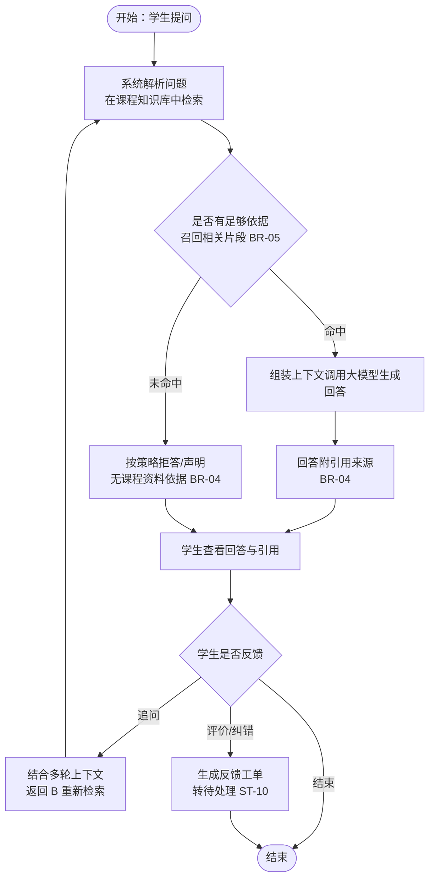
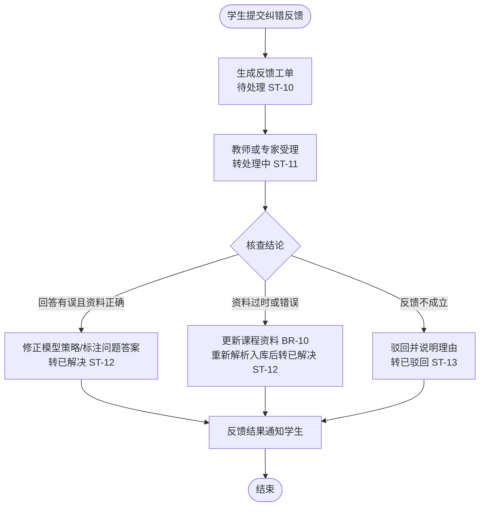
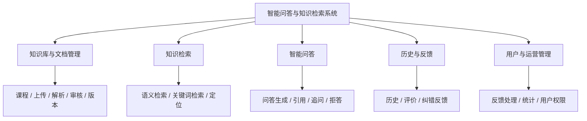
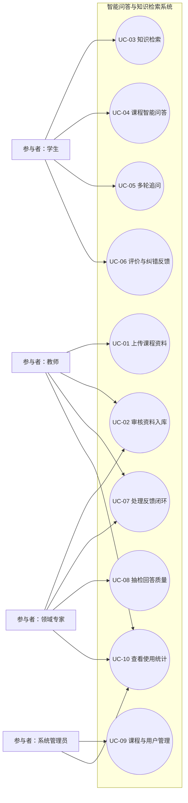
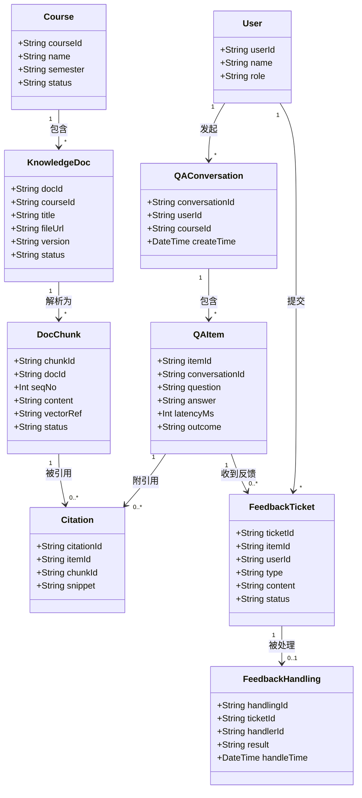
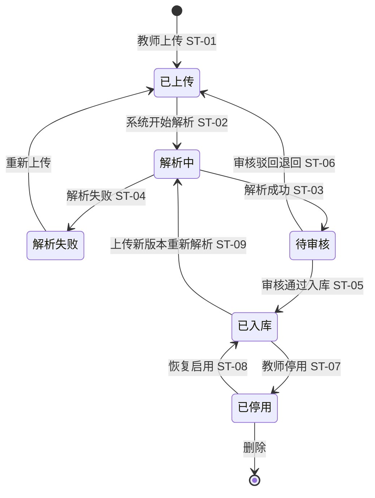
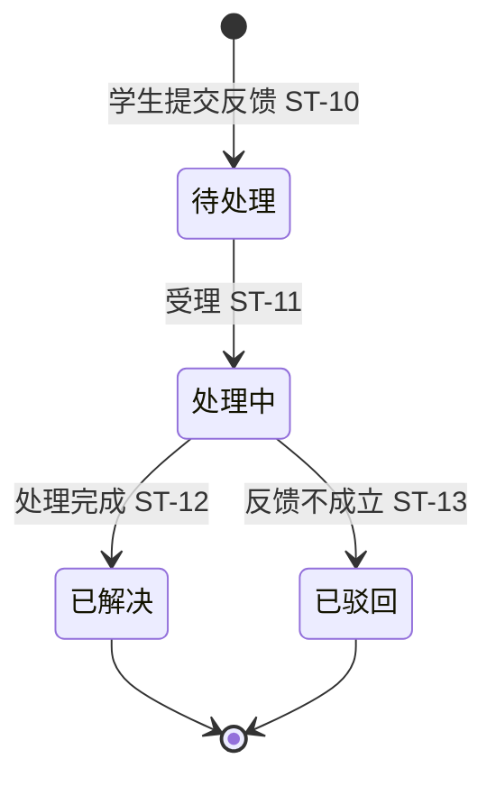

# 面向课程学习的智能问答与知识检索系统需求规格说明书

| 文档项 | 内容 |
|---|---|
| 文档编号 | SRS-02 |
| 项目名称 | 面向课程学习的智能问答与知识检索系统（专业领域系统项目） |
| 小组编号 | 【待填写】 |
| 成员名单 | 【待填写】 |
| 文档版本 | V1.0 |
| 编制日期 | 2026-10-15 |
| 状态 | 需求分析阶段稿 |

## 版本记录

| 版本 | 日期 | 修订内容 | 修订人 |
|---|---|---|---|
| V1.0 | 2026-10-15 | 初稿：领域背景、角色、业务流程、功能需求、业务规则、数据需求、状态模型、质量要求、领域术语表、不确定问题清单、待领域专家确认问题清单、AI 生成需求风险说明 | 【待填写】 |

---

## 1. 引言

### 1.1 编写目的

本文档描述"面向课程学习的智能问答与知识检索系统"（以下简称"本系统"）的领域背景、业务目标、系统范围、用户角色与权限、关键业务流程、功能需求、业务规则、数据需求、核心对象状态模型、质量要求，并按任务要求给出领域术语表、不确定问题清单、需要领域专家确认的问题清单以及 AI 生成需求中可能存在的风险说明。

本文档的预期读者：本课程教师与助教、项目组成员、参与评审的其他小组、受邀提供意见的领域专家（教学专家）。

### 1.2 项目背景

任务来源：`task/专业领域系统项目.md` 与《实践项目说明.pdf》第九节"专业领域系统项目"（可选案例 4）。该任务对需求分析提出了 7 项专项要求，本文档对应关系如下（作为专项要求覆盖性检查表）：

| 专项要求 | 覆盖章节 |
|---|---|
| 1. 领域背景初步说明 | 第 2 章 |
| 2. 关键角色识别 | 第 3 章 |
| 3. 关键业务流程 | 第 4 章 |
| 4. 领域术语表 | 第 10 章 |
| 5. 不确定问题清单 | 第 11 章 |
| 6. 需要领域专家确认的问题清单 | 第 12 章 |
| 7. AI 生成需求中可能存在的风险说明 | 第 13 章 |

### 1.3 文档约定

#### 1.3.1 编号体系

| 编号前缀 | 含义 |
|---|---|
| FR-xx | 功能需求 |
| UC-xx | 用例 |
| BR-xx | 业务规则 |
| ST-xx | 状态转换 |
| NFR-xx | 质量属性需求 |
| Q-Uxx | 不确定问题 |
| Q-Exx | 待领域专家确认问题 |
| R-xx | AI 生成需求风险条目 |

#### 1.3.2 规则来源性质标注

沿用《学生需求分析与 AI 智能体使用验证报告》A.2 节口径：

- **任务原文**：任务描述文件中明确给出的要求；
- **AI 候选**：任务未给定、由 AI 生成建议的数值或规则，**均为候选值，待确认**；
- **分析推导**：依据业务逻辑或技术原理推导得到的规则。

### 1.4 参考文献

1. `task/专业领域系统项目.md`——项目任务描述；
2. 《实践项目说明.pdf》第九节——贯穿式课程项目设计说明；
3. 《学生需求分析与 AI 智能体使用验证报告.md》——文档编写与确认口径依据；
4. IEEE Std 830-1998——软件需求规格说明书推荐结构（参考）。

---

## 2. 领域背景初步说明

### 2.1 业务领域与痛点

本系统属于**教育信息化 + 人工智能（检索增强生成）交叉领域**，服务高校课程学习场景。当前课程学习中的典型痛点：

1. **资料分散**：课件、讲义、实验指导、往届题库、FAQ 分散于多个平台，学生查找成本高；
2. **答疑压力大**：大量重复性问题占用教师与助教答疑时间，响应滞后；
3. **检索低效**：传统关键词检索难以处理自然语言式提问，无法直接给出答案；
4. **知识时效**：课程内容每学期更新，缺乏统一的知识库维护与版本管理机制。

### 2.2 技术背景

本系统拟采用**检索增强生成（RAG，Retrieval-Augmented Generation）**架构：将课程资料解析分块并向量化入库；用户提问时，先在课程知识库中检索相关内容片段，再交由大语言模型（LLM）基于检索结果生成回答并标注引用来源，以缓解大模型"幻觉"问题、保证回答可溯源。

### 2.3 业务目标与成功指标

图 GM-01：业务目标树（建模对象：系统业务目标）

成功指标目标值（均为 AI 候选，待确认）：

| 指标 | 目标值 | 来源性质 |
|---|---|---|
| 回答可溯源率 | 100%（有引用，或明确声明无课程资料依据） | 分析推导 |
| 抽检回答准确率 | ≥ 90% | AI 候选，待领域专家确认（见 Q-E01） |
| 问答响应时间 | ≤ 10 秒 | AI 候选，待确认 |
| 反馈闭环处理率 | 100% | 分析推导 |

### 2.4 系统上下文

图 GM-02：系统上下文图（建模对象：系统边界与外部交互）

### 2.5 系统范围

#### 2.5.1 范围内功能

1. 课程知识库管理：课程、资料文档的上传、解析、审核、更新、停用；
2. 知识检索：面向课程资料的自然语言/关键词检索，结果高亮与原文定位；
3. 智能问答：基于课程知识库生成回答，附引用来源，支持多轮追问与无依据拒答声明；
4. 问答历史与反馈：历史查询、回答评价、纠错反馈；
5. 反馈处理与运营：反馈工单处理闭环、热门问题与使用统计。

#### 2.5.2 范围外事项（用于界定边界，AI 候选，待确认）

- 作业/考试的自动批改与打分；
- 个性化学习路径推荐；
- 面向全校园的通用问答（本系统限定课程知识域）；
- 语音提问与语音播报；
- 教务系统（选课、成绩）数据打通。

### 2.6 假设与依赖

- 假设课程资料由教师或经授权人员提供，内容合法且无版权争议（版权问题见 Q-E08）；
- 依赖外部大语言模型服务的可用性与调用配额；
- 假设问答质量依赖知识库覆盖度，知识库外的课程问题按拒答/声明策略处理（BR-04）。

---

## 3. 关键角色识别

### 3.1 角色定义

| 角色 | 说明 | 主要职责 |
|---|---|---|
| 学生 | 选修课程的在校学生，系统主要服务对象 | 提问、检索、评价反馈、查看历史 |
| 教师 | 课程负责人或授课教师，课程知识库的主人 | 上传资料、审核入库、处理反馈、查看统计 |
| 领域专家 | 具备学科教学经验的专家（可由资深教师/助教或外请专家承担） | 抽检回答质量、确认知识修订、裁定争议答案 |
| 系统管理员 | 平台运维与管理人员 | 用户与权限管理、课程创建、系统配置 |
| 大语言模型服务 | 非人类执行者（外部系统） | 基于检索片段生成回答 |

### 3.2 权限矩阵

操作 × 角色权限对照（√ 允许，× 拒绝）：

| 操作 | 学生 | 教师 | 领域专家 | 系统管理员 | 关联需求 |
|---|---|---|---|---|---|
| 提问与追问 | √（限已选课程，候选） | √ | √ | × | FR-10、FR-11 |
| 知识检索 | √（限已选课程） | √ | √ | × | FR-07 |
| 查看回答引用并跳转原文 | √ | √ | √ | — | FR-09 |
| 上传课程资料 | × | √（本人课程） | × | × | FR-02 |
| 审核资料入库 | × | √（本人课程） | √ | × | FR-04、BR-03 |
| 更新/停用资料 | × | √（本人课程） | × | × | FR-05、FR-06 |
| 提交评价/纠错反馈 | √ | √ | √ | × | FR-14 |
| 处理反馈工单 | × | √ | √ | — | FR-15 |
| 抽检回答质量 | × | √ | √ | × | FR-15、Q-E02 |
| 查看课程使用统计 | × | √（本人课程） | √ | √（全局） | FR-16 |
| 用户与权限管理 | × | × | × | √ | FR-17 |
| 课程创建与归档 | × | × | × | √ | FR-01 |
| 查看他人问答历史 | ×（仅本人） | √（脱敏统计视角，候选 Q-U07） | √（抽检视角） | √ | FR-13 |

权限不足时系统明确拒绝并提示原因，不改变业务数据与状态。

---

## 4. 关键业务流程

### 4.1 知识库建设流程

图 GM-03：知识库建设活动图（建模对象：资料入库流程；关联需求：FR-01～FR-06；关联规则：BR-01～BR-03、BR-10）

### 4.2 智能问答流程

图 GM-04：智能问答活动图（建模对象：一次问答的完整处理；关联需求：FR-07～FR-12；关联规则：BR-04～BR-07）

### 4.3 反馈处理流程

图 GM-05：反馈处理活动图（建模对象：纠错反馈闭环；关联需求：FR-14～FR-15；关联规则：BR-08）

---

## 5. 功能需求

### 5.0 功能模块总览

图 GM-06：功能模块图（关联需求：FR-01～FR-17）

### 5.1 知识库与文档管理

| 编号 | 需求名称 | 需求描述 | 优先级 | 关联规则 |
|---|---|---|---|---|
| FR-01 | 课程管理 | 系统管理员创建课程、指定负责教师、归档课程；课程之间知识库相互隔离 | 高 | BR-09 |
| FR-02 | 资料上传 | 教师上传课程资料（讲义、课件、实验指导、FAQ 等），系统校验格式与大小 | 高 | BR-01、BR-02 |
| FR-03 | 解析与分块 | 系统自动解析文档并切分为语义分块，生成解析预览供审核 | 高 | BR-10 |
| FR-04 | 入库审核 | 教师/领域专家审核解析结果（内容与切分质量），通过后分块入库并建立检索索引 | 高 | BR-03 |
| FR-05 | 资料更新 | 教师上传新版本时，系统重建解析与索引，旧版本分块失效；版本记录可追溯 | 中 | BR-10 |
| FR-06 | 资料停用 | 教师可停用某资料，停用后其分块不再参与检索，已有引用标注"来源已停用" | 中 | BR-10 |

### 5.2 知识检索

| 编号 | 需求名称 | 需求描述 | 优先级 | 关联规则 |
|---|---|---|---|---|
| FR-07 | 知识检索 | 学生以自然语言或关键词检索课程资料，系统返回相关片段及出处文档 | 高 | BR-05、BR-09 |
| FR-08 | 结果排序与高亮 | 检索结果按相关度排序，命中关键词/语义片段高亮显示 | 中 | BR-05 |
| FR-09 | 原文定位 | 检索结果与回答引用可跳转至文档对应位置查看上下文 | 高 | BR-04 |

### 5.3 智能问答

| 编号 | 需求名称 | 需求描述 | 优先级 | 关联规则 |
|---|---|---|---|---|
| FR-10 | 课程问答 | 学生就课程内容提问，系统检索课程知识库后生成回答，**回答必须附引用来源**；与课程无关或敏感问题按策略拒答 | 高 | BR-04、BR-06、BR-07 |
| FR-11 | 多轮追问 | 支持在同一会话中结合上下文追问，追问回答同样附引用 | 中 | BR-04 |
| FR-12 | 无依据声明 | 检索未命中时，系统明确回答"课程资料中未找到依据"，不得编造引用 | 高 | BR-04 |
| FR-13 | 问答历史 | 学生查看本人会话历史；回答、引用与反馈状态随历史保留 | 中 | — |

### 5.4 历史与反馈

| 编号 | 需求名称 | 需求描述 | 优先级 | 关联规则 |
|---|---|---|---|---|
| FR-14 | 评价与纠错反馈 | 学生可对回答评价（有用/无用）并提交纠错反馈（描述错误之处） | 高 | BR-08 |
| FR-15 | 反馈处理闭环 | 教师/领域专家受理反馈，核查后处理（修正资料、标注问题答案或驳回），结果通知反馈人 | 高 | BR-08 |

### 5.5 用户与运营管理

| 编号 | 需求名称 | 需求描述 | 优先级 | 关联规则 |
|---|---|---|---|---|
| FR-16 | 使用统计 | 按课程统计提问量、热门问题、回答反馈情况，供教师与专家运营知识库 | 中 | — |
| FR-17 | 用户与权限管理 | 系统管理员管理账号、角色与课程关联关系 | 高 | 3.2 权限矩阵 |

### 5.6 用例模型

图 GM-07：系统用例图（Mermaid 表达 UML 用例语义；关联需求：FR-01～FR-17）

关键用例描述：

##### UC-04 课程智能问答

| 项目 | 内容 |
|---|---|
| 参与者 | 学生 |
| 前置条件 | 学生已登录并关联该课程；课程知识库存在已入库资料 |
| 主流程 | 1. 学生输入自然语言问题；2. 系统解析问题并在课程知识库检索（BR-05）；3. 命中相关片段后组装上下文调用大模型生成回答；4. 回答附引用来源，引用可跳转原文（BR-04、FR-09）；5. 学生可继续追问（UC-05）或反馈（UC-06） |
| 异常流程 | 2a. 检索未命中：回答"课程资料中未找到依据"，不生成引用（FR-12、BR-04）；2b. 问题与课程无关或命中敏感策略：拒答并说明（BR-07）；3a. 大模型调用超时/失败：提示稍后重试，不产生回答记录 |
| 后置条件 | 成功：会话与回答、引用、用时留存（FR-13）；失败：记录失败原因，不产生半成品回答 |
| 关联规则与转换 | BR-04～BR-07 |

##### UC-02 审核资料入库

| 项目 | 内容 |
|---|---|
| 参与者 | 教师（主）、领域专家 |
| 前置条件 | 存在"待审核"状态的已解析资料 |
| 主流程 | 1. 审核人查看解析预览与分块质量；2. 通过审核；3. 分块入库并建立索引，资料转"已入库"（ST-05），可被检索引用 |
| 异常流程 | 2a. 审核驳回：注明问题退回教师修改（转 ST-06，退回"已上传"） |
| 后置条件 | 通过：资料可被检索；驳回：不入库、不参与检索 |
| 关联规则与转换 | BR-03、ST-05、ST-06 |

其余用例（UC-01、UC-03、UC-05～UC-10）与 FR-02、FR-07、FR-11、FR-14～FR-17 对应，主流程与异常流程要点已在功能需求表中描述，场景推演详见后续 A.5 节。

---

## 6. 业务规则

| 编号 | 规则名称 | 规则内容 | 来源性质 | 确认状态 |
|---|---|---|---|---|
| BR-01 | 资料格式限制 | 支持 PDF、DOCX、PPTX、TXT、Markdown 格式 | AI 候选 | 待确认 |
| BR-02 | 单文件大小限制 | 单个资料文件不超过 50MB | AI 候选 | 待确认 |
| BR-03 | 先审后用 | 资料须经教师或领域专家审核通过后方可入库并参与检索与问答 | 分析推导 | 待确认 |
| BR-04 | 回答可溯源 | 回答必须附课程资料引用；检索未命中时须明确声明无依据，禁止编造引用 | 分析推导 | 待确认（核心可信规则） |
| BR-05 | 检索策略 | 每次问答默认召回相关度最高的 5 个分块（TOP-K=5） | AI 候选 | 待确认 |
| BR-06 | 会话隔离 | 问答检索范围限于当前课程知识库 | AI 候选 | 待确认（跨课程问题见 Q-U06） |
| BR-07 | 拒答策略 | 与课程无关的问题、涉及敏感内容的问题拒绝回答并说明原因 | AI 候选（边界需专家确认，见 Q-E09） | 待确认 |
| BR-08 | 反馈时限 | 纠错反馈应在 3 个工作日内受理处理并反馈结论 | AI 候选 | 待确认 |
| BR-09 | 课程隔离 | 不同课程的知识库相互隔离，检索与问答不跨课程引用 | AI 候选 | 待确认 |
| BR-10 | 版本与索引一致性 | 资料更新或停用后，其旧分块立即退出检索索引；历史回答中的引用标注来源版本状态 | 分析推导 | 待确认 |

> 除注明"分析推导"外均为候选规则；"分析推导"规则亦需教学模拟或专家复核。确认记录归档于 A.2 节。

---

## 7. 数据需求

### 7.1 领域类图

图 GM-08：领域类图（建模对象：核心业务实体；与第 10 章术语表一致）

说明：领域专家、教师、学生均为 User 的角色（以 role 区分）；向量库、索引属于实现层组件，需求阶段以 DocChunk.vectorRef 关联表达。

### 7.2 数据字典（核心实体）

#### 7.2.1 课程 Course

| 字段 | 类型 | 说明 | 约束 |
|---|---|---|---|
| courseId | 字符串 | 课程编号，唯一 | 主键 |
| name | 字符串 | 课程名称 | 必填 |
| semester | 字符串 | 开课学期 | 必填 |
| status | 枚举 | 开设中/已归档 | 归档后只读 |

#### 7.2.2 知识文档 KnowledgeDoc

| 字段 | 类型 | 说明 | 约束 |
|---|---|---|---|
| docId | 字符串 | 文档编号，唯一 | 主键 |
| courseId | 字符串 | 所属课程 | 外键→Course |
| title / fileUrl | 字符串 | 标题与存储位置 | 必填 |
| version | 字符串 | 版本号 | 更新时递增（BR-10） |
| status | 枚举 | 已上传/解析中/解析失败/待审核/已入库/已停用 | 见 8.1 |

#### 7.2.3 分块 DocChunk

| 字段 | 类型 | 说明 | 约束 |
|---|---|---|---|
| chunkId | 字符串 | 分块编号，唯一 | 主键 |
| docId | 字符串 | 来源文档 | 外键→KnowledgeDoc |
| seqNo | 整数 | 在文档中的顺序号 | — |
| content | 文本 | 分块内容 | 非空 |
| vectorRef | 字符串 | 向量索引引用 | 由解析生成 |
| status | 枚举 | 生效/已失效 | 随文档版本变化（BR-10） |

#### 7.2.4 问答 QAConversation / QAItem / Citation

| 字段 | 类型 | 说明 | 约束 |
|---|---|---|---|
| conversationId | 字符串 | 会话编号 | 主键 |
| itemId | 字符串 | 单轮问答编号 | 主键 |
| question / answer | 文本 | 问题与生成的回答 | answer 可为拒答声明（BR-04） |
| outcome | 枚举 | 已回答/拒答/无依据声明/生成失败 | 与 FR-10～FR-12 对应 |
| latencyMs | 整数 | 生成耗时 | 用于 NFR-03 统计 |
| citationId / chunkId / snippet | 字符串/文本 | 引用编号、被引分块、摘录片段 | 引用必须指向生效分块（BR-04、BR-10） |

#### 7.2.5 反馈 FeedbackTicket / FeedbackHandling

| 字段 | 类型 | 说明 | 约束 |
|---|---|---|---|
| ticketId | 字符串 | 工单编号 | 主键 |
| itemId | 字符串 | 关联问答 | 外键→QAItem |
| type | 枚举 | 评价（有用/无用）/纠错 | — |
| content | 文本 | 反馈描述 | 纠错时必填 |
| status | 枚举 | 待处理/处理中/已解决/已驳回 | 见 8.2，时限见 BR-08 |
| result（处理记录） | 文本 | 处理结论与依据 | 处理人必填 |

---

## 8. 状态模型

### 8.1 知识文档状态模型

图 GM-09：知识文档状态图（建模对象：KnowledgeDoc；关联需求：FR-02～FR-06；关联规则：BR-01～BR-03、BR-10）

状态转换说明表：

| 转换编号 | 当前状态 | 触发事件 | 执行角色 | 条件或判定依据 | 目标状态及业务结果 | 失败或拒绝时处理 |
|---|---|---|---|---|---|---|
| ST-01 | （无） | 上传资料 | 教师 | 格式符合 BR-01；大小符合 BR-02 | 转"已上传"；生成文档记录（版本 V1） | 校验不过：拒绝接收，提示原因；不生成记录 |
| ST-02 | 已上传 | 触发解析 | 系统 | 文档处于"已上传" | 转"解析中"；执行解析分块（FR-03） | 解析服务不可用：保持"已上传"，记录日志重试 |
| ST-03 | 解析中 | 解析成功 | 系统 | 成功产出分块与预览 | 转"待审核"；分块待审、不参与检索（BR-03） | — |
| ST-04 | 解析中 | 解析失败 | 系统 | 格式损坏/内容为空等 | 转"解析失败"；提示教师处理 | — |
| ST-05 | 待审核 | 审核通过 | 教师/领域专家 | 审核人具权限（3.2）；分块质量合格 | 转"已入库"；分块生效并进入检索索引 | 不具权限或未审核：保持"待审核" |
| ST-06 | 待审核 | 审核驳回 | 教师/领域专家 | 审核人具权限；注明驳回原因 | 退回"已上传"；通知教师修改，分块不参与检索 | 不具权限时拒绝；状态保持"待审核" |
| ST-07 | 已入库 | 停用资料 | 教师 | 教师本人课程 | 转"已停用"；分块退出索引，历史引用标注"来源已停用"（BR-10） | 无权限拒绝；状态保持"已入库" |
| ST-08 | 已停用 | 恢复启用 | 教师 | 教师本人课程 | 转"已入库"；分块重新生效 | 无权限拒绝；状态保持"已停用" |
| ST-09 | 已入库 | 上传新版本 | 教师 | 教师本人课程 | 转"解析中"；新版本走 ST-03～ST-05 流程，旧分块在入库时失效（BR-10） | 新版本审核未通过时旧版本继续生效 |

图注：① 状态图中"解析失败 → 重新上传"属 ST-04 的失败处理路径（教师处理后回到"已上传"，重新触发 ST-02）；②"已停用 → 删除"为终态归档操作，仅允许教师对本人课程已停用文档执行，删除后分块不可恢复、历史引用标注"来源已删除"。

### 8.2 反馈工单状态模型

图 GM-10：反馈工单状态图（建模对象：FeedbackTicket；关联需求：FR-14、FR-15；关联规则：BR-08）

| 转换编号 | 当前状态 | 触发事件 | 执行角色 | 条件或判定依据 | 目标状态及业务结果 | 失败或拒绝时处理 |
|---|---|---|---|---|---|---|
| ST-10 | （无） | 提交评价/纠错 | 学生 | 关联有效问答；纠错内容非空 | 转"待处理"；生成工单并计时（BR-08） | 内容为空：拒绝提交，提示补充 |
| ST-11 | 待处理 | 受理 | 教师/领域专家 | 处理人具权限 | 转"处理中"；记录受理人与时间 | 无权限拒绝；工单保持"待处理" |
| ST-12 | 处理中 | 处理完成 | 教师/领域专家 | 已采取措施（修正资料/标注答案），填写结论 | 转"已解决"；通知反馈人；必要时触发 BR-10 索引更新 | 结论为空：不允许办结，保持"处理中" |
| ST-13 | 处理中 | 驳回 | 教师/领域专家 | 反馈不成立，说明理由 | 转"已驳回"；通知反馈人理由 | 理由为空：不允许驳回，保持"处理中" |

---

## 9. 质量要求（非功能需求）

| 编号 | 类别 | 要求 | 来源性质 |
|---|---|---|---|
| NFR-01 | 准确性 | 回答抽检准确率 ≥ 90%（抽检方案由领域专家确认，见 Q-E01、Q-E02） | AI 候选，待确认 |
| NFR-02 | 可追溯性 | 100% 的回答要么附有效引用，要么明确声明无课程资料依据；引用可跳转原文 | 分析推导（BR-04 支撑） |
| NFR-03 | 性能 | 问答端到端响应 ≤ 10 秒；检索结果返回 ≤ 3 秒 | AI 候选，待确认 |
| NFR-04 | 性能 | 支持不低于 200 名用户同时在线提问/检索 | AI 候选，待确认 |
| NFR-05 | 可用性 | 系统周可用性 ≥ 99%；大模型服务不可用时给出明确提示并支持重试 | AI 候选，待确认 |
| NFR-06 | 安全与合规 | 课程知识库按课程隔离（BR-09）；学生问答数据仅本人与授权角色可见；数据用途遵守学校规定（见 Q-U07） | 分析推导 |
| NFR-07 | 可维护性 | 课程、资料、分块、索引支持在线维护；模型服务与参数可配置替换 | 分析推导 |
| NFR-08 | 可审计性 | 上传、审核、入库、停用、反馈处理全程留痕（操作人、时间、结论） | 分析推导 |
| NFR-09 | 内容安全 | 拒答策略覆盖敏感与无关内容（BR-07），策略可由管理员维护 | AI 候选，待确认 |

---

## 10. 领域术语表

| 术语 | 英文/缩写 | 定义 |
|---|---|---|
| 课程知识库 | Course Knowledge Base | 面向一门课程、经审核入库的资料分块及其索引的总和，课程间相互隔离（BR-09） |
| 知识文档 | Knowledge Document | 教师上传的原始资料文件（讲义、课件、实验指导、FAQ 等），具有版本与状态 |
| 文档分块 | Chunking / Chunk | 将文档按语义切分后的最小检索单元，带顺序号与来源定位 |
| 向量化 | Embedding | 将文本转换为向量表示的过程，用于语义相似度计算 |
| 语义检索 | Semantic Search | 基于向量相似度，按语义相关性匹配问题与分块的检索方式 |
| 关键词检索 | Keyword Search | 基于词项匹配的传统检索方式 |
| 召回 | Recall | 从知识库中取回候选分块的过程，本系统默认 TOP-K=5（BR-05） |
| 检索增强生成 | RAG, Retrieval-Augmented Generation | 先检索课程资料、再让大模型基于检索结果生成回答的技术架构 |
| 大语言模型 | LLM | 负责生成自然语言回答的模型服务 |
| 提示词 | Prompt | 发送给大模型的输入，包含问题与召回的课程片段 |
| 引用溯源 | Citation | 回答中标注的来源信息，指向具体文档分块并可跳转原文（BR-04） |
| 幻觉 | Hallucination | 大模型生成看似合理但与资料不符或无依据内容的现象 |
| 拒答 | Refusal | 系统对无关、敏感或无依据问题明确不予作答的策略（BR-07、BR-04） |
| 无依据声明 | No-evidence Disclaimer | 检索未命中时，系统明确说明课程资料中未找到依据的响应方式 |
| 反馈闭环 | Feedback Loop | 从学生反馈到处理、修订、通知的完整处理链路（FR-14、FR-15） |
| 领域专家 | Domain Expert | 具备学科教学经验、参与回答质量裁定与知识确认的人员 |
| 入库审核 | Ingestion Review | 资料解析后、入库生效前的质量审核环节（BR-03） |
| 命中 | Hit | 检索结果中与问题相关的分块被采信的状态 |
| 会话 | Conversation | 一次连续的问答过程，包含若干轮问答与上下文 |

---

## 11. 不确定问题清单

以下问题在需求分析阶段尚未确定，按影响程度列出；确认方式见"当前处理"列。

| 编号 | 不确定问题 | 影响范围 | 当前处理 |
|---|---|---|---|
| Q-U01 | 是否接入校园统一认证，还是本系统独立注册登录 | 用户管理（FR-17）、上下文图 | 暂按支持独立注册设计，预留认证接口；待与教学模拟业务方确认 |
| Q-U02 | 首期覆盖范围：单门课程试点还是多门课程 | 课程管理（FR-01）、部署容量（NFR-04） | 按多课程设计、单课程试点验证；容量数值保持候选 |
| Q-U03 | 服务入口形态：仅 Web 还是需要适配移动端 | 界面需求、可用性 | 暂按响应式 Web；移动端专项待确认 |
| Q-U04 | 允许哪些角色上传资料：仅教师，还是学生可投稿（经审核入库） | FR-02、BR-03 审核流程 | 暂定仅教师可上传，学生投稿列为候选扩展 |
| Q-U05 | 大模型选型：商用 API 还是本地部署开源模型（涉及成本、数据外发合规） | 架构、NFR-06、预算 | 需求阶段仅约束"模型服务可配置"（NFR-07），选型延后决策 |
| Q-U06 | 是否支持跨课程检索（学生同时选多门课时的合并提问） | BR-06、BR-09、检索设计 | 暂按课程隔离；跨课程列为范围外候选 |
| Q-U07 | 学生提问数据是否允许用于教学质量分析（脱敏与否） | NFR-06、FR-16、隐私合规 | 暂按"仅授权角色可查看脱敏统计"；需教师/专家确认 |
| Q-U08 | 并发与数据量规模（选课人数上限、资料总量级） | NFR-03、NFR-04 | 采用候选值，待试点课程数据校准 |
| Q-U09 | 是否需要历史会话的导出/删除功能（个人数据权利） | FR-13、NFR-06 | 暂按本人可查、管理员可删；导出列为候选 |

---

## 12. 需要领域专家确认的问题清单

以下问题需领域专家（教学专家）或教师角色确认，建议通过教学模拟访谈完成并记录（注明"教学模拟"）。

| 编号 | 待确认问题 | 关联需求/规则 | 建议确认方式 |
|---|---|---|---|
| Q-E01 | "合格回答"的验收标准：抽检准确率目标值（本文档候选 90%）与评测方法 | NFR-01 | 专家访谈 + 试评样本集 |
| Q-E02 | 回答质量抽检机制：抽样比例、频次、判定口径 | NFR-01、FR-15、UC-08 | 专家访谈 |
| Q-E03 | 引用颗粒度：章节级还是段落级；引用摘录的展示格式 | BR-04、FR-09 | 专家 + 学生代表试用确认 |
| Q-E04 | 知识库更新频率与时效要求：资料更新后多长时间内必须可被检索 | FR-05、BR-10 | 教师访谈 |
| Q-E05 | 每份资料是否必须经专家审核（还是教师自审即可） | BR-03、FR-04 | 教学模拟讨论 |
| Q-E06 | 作业/考试期间的使用限制策略（学术诚信边界：何种问题必须拒答） | BR-07、FR-10 | 教师角色模拟 + 课程规定 |
| Q-E07 | 发现错误回答的处置流程：下线、标注、通知的范围与时限 | FR-15、ST-12 | 专家访谈 |
| Q-E08 | 含版权课件的入库许可与使用边界 | FR-02、BR-01 | 教师/法务咨询（超出小组权限则列入范围外） |
| Q-E09 | 拒答策略边界：无关问题、敏感主题的具体清单 | BR-07、NFR-09 | 教学模拟 + 管理员维护策略 |
| Q-E10 | 反馈处理时限 3 个工作日（BR-08）是否合理 | BR-08 | 教师角色模拟 |

---

## 13. AI 生成需求中可能存在的风险说明

本需求文档在编制过程中使用了 AI 辅助生成，以下为识别出的主要风险、在本文档中的具体表现及已采取的缓解措施，供评审与后续核验参考。

| 编号 | 风险类型 | 具体表现（本文档中的例子） | 缓解措施与处理状态 |
|---|---|---|---|
| R-01 | 幻觉风险 | AI 可能生成看似专业但无真实依据的技术参数（如"TOP-K=5"“准确率 90%”） | 此类数值全部标注"AI 候选，待确认"，列入 Q-E01/E02 确认清单；不作为已确认事实 |
| R-02 | 同源生成与伪一致性 | 文档各章节均由同一 AI 生成，章节间相互印证不等于经过独立验证 | 采用编号交叉引用强制自洽检查 + 人工逐节复核；确认状态以人工记录（A.2 节）为准 |
| R-03 | 过度补全 | AI 建议了任务未要求的功能（如个性化学习路径推荐、积分体系、语音交互） | 已剔除并写入 2.5.2 范围外清单，防止范围蔓延 |
| R-04 | 数值凭空设定 | 文件大小 50MB、响应 10 秒、并发 200 人等数值无业务依据 | 全部标注候选，集中在 BR 表、NFR 表与 Q-U08，待试点/专家确认 |
| R-05 | 术语漂移 | 不同生成片段中"资料/语料/文档"混用 | 建立第 10 章领域术语表，全文按统一术语修订（统一为"知识文档/资料"） |
| R-06 | 领域知识局限 | AI 不了解本校课程设置、教学流程与版权约定 | 相关不确定点集中到第 11、12 章清单，交由教学模拟与领域专家确认 |
| R-07 | 过度乐观的质量承诺 | "回答 100% 可溯源"依赖工程实现，若检索或引用链路出错则无法达成 | NFR-02 保持为目标要求并注明依赖 BR-04 与实现约束；验收时以实际测试为准 |
| R-08 | 需求间潜在冲突未被 AI 识别 | 如 BR-09 课程隔离与多选课学生的使用便利性冲突 | 已识别为 Q-U06 列入不确定清单；其余冲突通过场景走查（A.5 节）继续排查 |

---

## 14. 附录

### 附录 A：待确认候选规则汇总

| 规则编号 | 候选内容 | 拟确认方式 |
|---|---|---|
| BR-01 | 支持格式 PDF/DOCX/PPTX/TXT/MD | 团队复核 |
| BR-02 | 单文件 ≤ 50MB | 团队复核 |
| BR-04 | 回答必须附引用或声明无依据 | 教学模拟（核心规则，优先确认） |
| BR-05 | TOP-K = 5 | 领域专家/技术验证 |
| BR-06 / BR-09 | 问答与知识库按课程隔离 | 教学模拟 + Q-U06 |
| BR-07 | 无关/敏感问题拒答 | Q-E09 专家确认 |
| BR-08 | 反馈 3 个工作日内处理 | Q-E10 |
| BR-10 | 更新停用后旧索引立即失效 | 团队复核 |

### 附录 B：图模型索引

| 图编号 | 图名称 | 建模对象 | 所在章节 |
|---|---|---|---|
| GM-01 | 业务目标树 | 业务目标层级 | 2.3 |
| GM-02 | 系统上下文图 | 系统边界与外部交互 | 2.4 |
| GM-03 | 活动图 | 知识库建设流程 | 4.1 |
| GM-04 | 活动图 | 智能问答流程 | 4.2 |
| GM-05 | 活动图 | 反馈处理流程 | 4.3 |
| GM-06 | 功能模块图 | 功能结构 | 5.0 |
| GM-07 | 用例图 | 系统级用例 | 5.6 |
| GM-08 | 领域类图 | 核心业务实体 | 7.1 |
| GM-09 | 状态图 | 知识文档 | 8.1 |
| GM-10 | 状态图 | 反馈工单 | 8.2 |

### 附录 C：与其他交付文档的关系

- 本文档 FR/UC/BR/ST/NFR/Q-U/Q-E/R 编号将被《A. 需求分析质量验证报告》与《B. AI 智能体使用验证报告》直接引用；
- 第 11、12 章清单的确认记录归档于 A.2 节；第 13 章风险条目（R-xx）供 B 报告"人工质疑与风险检查"引用。
