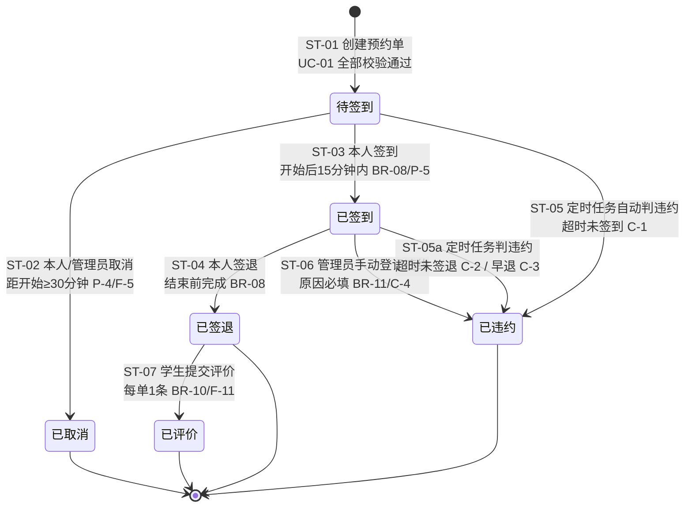
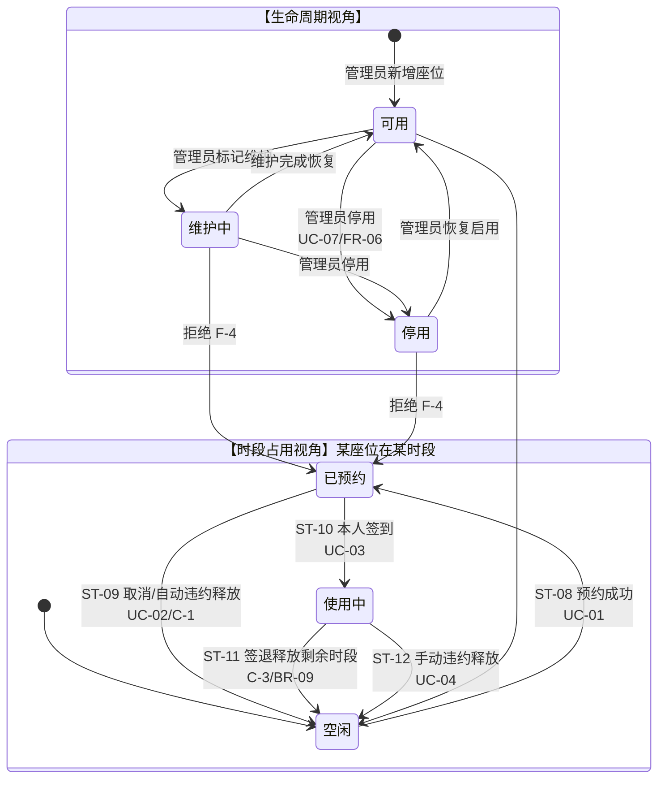
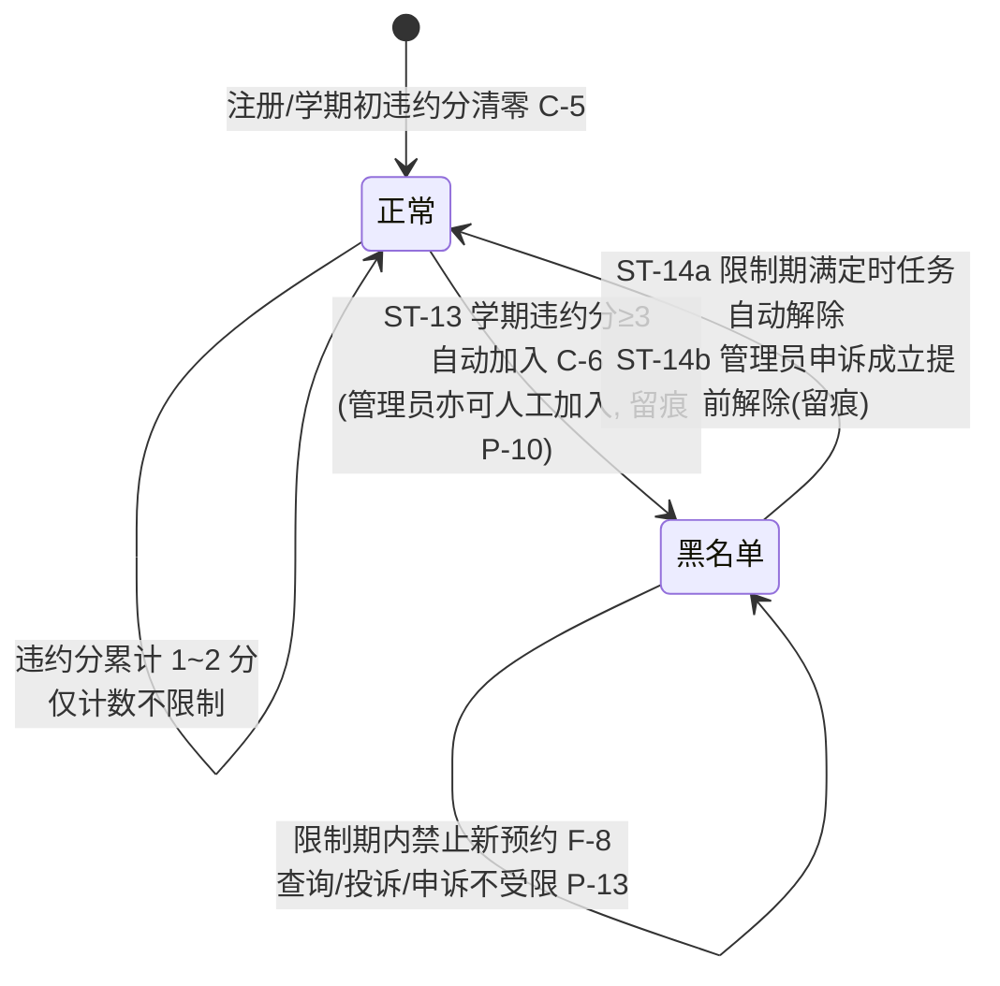
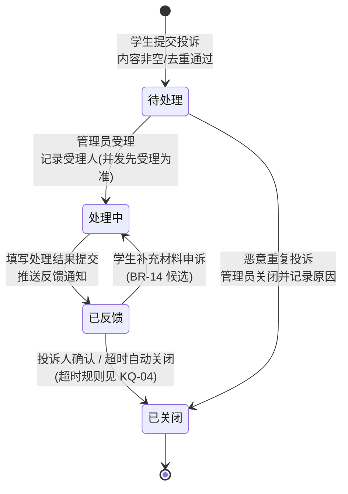

# 行为与状态

> 应能够查到的内容：核心业务过程、对象生命周期、异常处置
> 推荐表示形式：活动图、状态图、转换说明

本章节依据《用户需求》的用例（UC-01～UC-15）与《规则与权限》的规则（P/F/C 系列）编写。所有状态转换编号 ST-xx 与《需求分析》其他章节（用例表的"状态转换"列、《领域与数据》DD05）共用，修改时须同步更新。

## 1. 核心业务过程（活动图）

### 1.1 图 GM-05：预约—签到—签退—评价主流程活动图

- 编号与名称：GM-05 预约主流程活动图
- 建模对象：UC-01、UC-02、UC-03、UC-09 组成的核心业务闭环
- 关联需求：FR-07～FR-12、FR-24；关联规则：BR-01～BR-05、BR-08～BR-10、P-1、P-2、P-4、P-5、F-1、F-2、F-4、C-1～C-3
- 可编辑源文件：`docs/diagrams/GM-05-预约主流程活动图.mmd`

```mermaid
flowchart TD
    Start((●)) --> Login[已登录学生发起选座]
    Login --> Query[按日期/时段/自习室/属性筛选<br/>系统计算可用座位集合 FR-05/FR-07]
    Query --> Pick[选定座位与时段并提交]
    Pick --> Chk1{黑名单限制期内?<br/>F-8/BR-07}
    Chk1 -->|是| Deny1[拒绝: 提示限制截止日期<br/>UC-12] --> End1((◉))
    Chk1 -->|否| Chk2{开始时间是过去时间<br/>或超出 7 天窗口? F-1/P-2}
    Chk2 -->|是| Deny2[拒绝: 提示允许范围] --> End1
    Chk2 -->|否| Chk3{座位停用/维护中? F-4}
    Chk3 -->|是| Deny3[拒绝: 座位不可用] --> End1
    Chk3 -->|否| Chk4{与本人预约时段重叠<br/>或已有 2 个有效预约? F-2/P-1}
    Chk4 -->|是| Deny4[拒绝: 列出冲突单号/上限提示] --> End1
    Chk4 -->|否| Chk5{该座位该时段已被占用?<br/>BR-04/并发 UC-13}
    Chk5 -->|是| Deny5[拒绝: 时段已被占用<br/>引导重选] --> End1
    Chk5 -->|否| Create[生成"待签到"预约单<br/>座位时段→已预约 ST-01/ST-08<br/>推送预约成功通知]
    Create --> Wait{学生按时到场?}
    Wait -->|取消: 距开始≥30分钟 P-4| Cancel[预约单→已取消 ST-02<br/>座位时段释放 ST-09<br/>不计违约 UC-02] --> End1
    Wait -->|开始后 15 分钟内到场| CheckIn[学生点击签到<br/>预约单→已签到 ST-03<br/>座位→使用中 ST-10 UC-03]
    Wait -->|超时未签到 C-1| AutoViol1[定时任务判违约<br/>预约单→已违约 ST-05<br/>释放座位、违约分+1、通知 UC-06]
    AutoViol1 --> End1
    CheckIn --> Use[使用中]
    Use -->|提前离开≥30分钟 C-3| Early[记"早退"违约<br/>回收剩余时段]
    Use -->|结束+15分钟未签退 C-2| AutoViol2[定时任务记"超时未签退"违约]
    Use -->|正常签退| CheckOut[预约单→已签退 ST-04<br/>剩余时段释放 ST-11]
    Early --> Score
    AutoViol2 --> End1
    CheckOut --> Score{签退后评价? BR-10/P-6}
    Score -->|提交 1~5 星 + 文字| Review[创建评价记录 UC-09<br/>每预约单限 1 条 F-11] --> End1
    Score -->|跳过| End1
```

图注：

1. 六边形判定按《规则与权限》7.1、7.3 决策表的优先级顺序排列，命中即停止，与决策表一致。
2. "学生按时到场?"分支汇总了取消、签到、超时违约三条路径；管理员手动违约（UC-04）发生在"使用中"阶段，见 1.2 的管理端活动图。
3. 早退违约（C-3）按 BR-20 记违约后仍允许进入评价，评价前置条件是"已签退"（BR-10）。

### 1.2 图 GM-06：管理员实时管理与违约治理活动图

- 编号与名称：GM-06 管理员实时管理与违约治理活动图
- 建模对象：UC-04（手动违约登记）、UC-06（违约累计与黑名单）、UC-05（投诉处理）、UC-07（座位停用）
- 关联需求：FR-06、FR-17～FR-20、FR-27～FR-30；关联规则：BR-07、BR-11、BR-12、C-4～C-6、P-7～P-10、F-7、F-10
- 可编辑源文件：`docs/diagrams/GM-06-管理端活动图.mmd`

```mermaid
flowchart TD
    Start((●)) --> Board[管理员打开实时座位看板 FR-18<br/>查看 空闲/已预约/使用中/停用]
    Board --> Found{发现"使用中"座位违规?<br/>无人/占座/非本人使用}
    Found -->|否| Record[查看座位使用与预约记录 FR-17<br/>复盘争议] --> End0((◉))
    Found -->|是| Detail[进入座位详情<br/>查看当前使用人必要信息]
    Detail --> Reg[点击"登记违约"<br/>填写类型与原因(必填) BR-11]
    Reg --> VChk{权限通过 且<br/>预约单状态="已签到"?}
    VChk -->|否| VDeny[拒绝登记并提示原因<br/>状态保持原值 UC-04 异常流程] --> End0
    VChk -->|是| Manual[生成"手动违约"记录<br/>含操作人/时间/原因, 留痕 BR-12<br/>预约单→已违约 ST-06<br/>座位→空闲 ST-12, 违约分+1 C-4/C-5]
    Manual --> Count[系统按学期滚动累计违约分 C-5]
    Count --> Threshold{学期内违约分 ≥ 3? C-6}
    Threshold -->|否| Notify[推送违约通知] --> End0
    Threshold -->|是 且不在黑名单| AddBL[自动加入黑名单 ST-13<br/>限制期=7天×进入次数, 上限30天<br/>推送加入通知 FR-30]
    AddBL --> BLPeriod{限制期处理}
    BLPeriod -->|到期| Release[定时任务自动解除 ST-14<br/>恢复预约资格, 推送通知]
    BLPeriod -->|学生申诉且管理员判定成立| EarlyRel[管理员提前解除<br/>填写理由并留痕 FR-29]
    BLPeriod -->|限制期内| Block[新预约在 UC-01 第 4 步被拦截 UC-12]
    Release --> End0
    EarlyRel --> End0
    Block --> End0
    Board -.座位故障.-> Stop[停用座位 UC-07<br/>座位→停用]
    Stop --> AutoCancel[自动取消未来未开始时段的预约<br/>并通知 FR-06<br/>已签到/使用中的处理见 KQ-07]
    AutoCancel --> End0
    Board -.-> Complaint[处理投诉: 受理→处理中→填写结果<br/>→已反馈, 结果推送投诉人 UC-05]
    Complaint --> End0
```

图注：

1. 手动违约（C-4）与自动违约（C-1～C-3）统一计入违约分（C-5），二者在同一计数通道汇合。
2. 黑名单期内再违约是否延长限制期见 KQ-09（候选：重新计时），图中未展开该分支。
3. 投诉处理与座位停用以虚线表示从看板可触发的其他管理动作，详细状态机见 2.6。

## 2. 对象生命周期（状态图）

### 2.1 图 GM-07：预约单状态图

- 编号与名称：GM-07 预约单状态图（核心对象）
- 建模对象：预约单（TER-05、DD03/DD05）的完整生命周期
- 关联用例：UC-01～UC-04、UC-09；关联规则：BR-05、BR-08、BR-10、BR-11、C-1～C-4、F-5、F-6
- 可编辑源文件：`docs/diagrams/GM-07-预约单状态图.mmd`



### 2.2 转换说明：预约单

| 编号 | 起始状态 → 目标状态 | 触发事件 | 守卫条件 / 动作 | 关联规则 |
|---|---|---|---|---|
| ST-01 | （无）→ 待签到 | 学生提交预约（或管理员代约，须留痕） | 全部校验通过（黑名单、时间窗、重叠、上限、占用、并发）；座位时段转"已预约"（ST-08） | BR-02～BR-04、BR-07、P-1、P-2、P-8 |
| ST-02 | 待签到 → 已取消 | 学生/管理员发起取消 | 距开始 ≥ 30 分钟；座位时段释放（ST-09）；不计违约 | BR-05、P-4、F-5 |
| ST-03 | 待签到 → 已签到 | 学生点击签到（仅本人，F-6） | 当前时间在签到窗口内（开始后 15 分钟）；座位转"使用中"（ST-10）；重复签到幂等 | BR-08、P-5 |
| ST-04 | 已签到 → 已签退 | 学生点击签退（仅本人） | 剩余时段即时释放（ST-11）；早退 ≥ 30 分钟另记 C-3 违约 | BR-09、C-3 |
| ST-05 | 待签到 → 已违约 | 定时任务扫描 | 当前时间 > 开始 + 15 分钟且未签到；生成自动违约记录，违约分 +1；座位释放；通知本人；同一预约只判一次（幂等） | C-1、C-5、F-7 |
| ST-05a | 已签到 → 已违约 | 定时任务扫描 / 学生签退动作 | 超时未签退（C-2）或早退（C-3）；生成违约记录并计分 | C-2、C-3 |
| ST-06 | 已签到 → 已违约 | 管理员手动登记 | 预约单须处于"已签到"；类型与原因必填；留痕（操作人/时间/原因）；座位释放（ST-12）；违约分 +1 | BR-11、BR-12、C-4、P-9 |
| ST-07 | 已签退 → 已评价 | 学生提交评价 | 每预约单 1 条；1～5 星；不引起预约单其他转换 | BR-10、P-6、F-11 |

> 终态说明：已取消、已签退、已违约、已评价均为终态，预约单不可从终态再发生任何转换（取消是"待签到"专属操作，签到是"待签到"专属操作）；"已评价"是"已签退"的附属标记，审计口径上仍属正常完结。管理员不能直接修改预约单状态，仅能通过 ST-02（代取消）与 ST-06（手动违约）两个受控动作间接终止（PS-03）。

### 2.3 图 GM-08：座位状态图（两个视角）

- 编号与名称：GM-08 座位状态图
- 建模对象：座位（TER-02、DD02）。座位有两个正交视角：**生命周期视角**（管理员维护）与**时段占用视角**（预约驱动，按"座位×时段"计），合并绘制并注明视角
- 关联用例：UC-01～UC-04、UC-07、UC-10；关联规则：F-4、P-7、C-7
- 可编辑源文件：`docs/diagrams/GM-08-座位状态图.mmd`



### 2.4 转换说明：座位

| 编号 | 起始状态 → 目标状态 | 触发事件 | 守卫条件 / 动作 | 关联规则 |
|---|---|---|---|---|
| ST-08 | 空闲 → 已预约 | UC-01 预约成功 | 同一座位同一时段至多 1 个有效预约，并发提交仅一方成功 | BR-04、F-4 |
| ST-09 | 已预约 → 空闲 | 取消预约（ST-02）或超时未签到自动违约（ST-05） | 即时释放，可被他人预约 | BR-05、C-1 |
| ST-10 | 已预约 → 使用中 | 本人签到（ST-03） | 座位实时状态按 C-7 计算，"使用中"优先于"已预约" | C-7 |
| ST-11 | 使用中 → 空闲 | 本人签退（ST-04） | 自签退时刻起剩余时段释放；早退 ≥ 30 分钟记 C-3 违约 | BR-09、C-3 |
| ST-12 | 使用中 → 空闲 | 管理员手动违约（ST-06） | 留痕并通知被登记学生 | BR-11、C-4 |
| — | 可用 ↔ 维护中 / 停用 | 管理员维护操作 | 维护中/停用座位禁止被预约；停用时自动取消未来未开始预约并通知（FR-06）；已签到/使用中预约的处置见 KQ-07 | F-4、P-7 |

> 看板展示的实时状态由 C-7 计算：停用/维护中（管理员设置优先）> 使用中 > 已预约 > 可用；不依赖状态字段被及时刷新。

### 2.5 图 GM-09：用户信用状态图（正常 / 黑名单）

- 编号与名称：GM-09 用户信用状态图
- 建模对象：学生的预约资格（黑名单，TER-09、DD07）
- 关联用例：UC-06、UC-12；关联规则：BR-07、C-5、C-6、P-10、P-13、F-8
- 可编辑源文件：`docs/diagrams/GM-09-用户信用状态图.mmd`



| 编号 | 起始状态 → 目标状态 | 触发事件 | 守卫条件 / 动作 | 关联规则 |
|---|---|---|---|---|
| ST-13 | 正常 → 黑名单 | 违约记录写入后系统判定 / 管理员人工加入 | 学期累计违约分 ≥ 3 且当前不在黑名单（幂等）；限制期 = 7 天 × 进入次数（上限 30 天）；推送加入通知 | C-5、C-6、BR-07 |
| ST-14a | 黑名单 → 正常 | 定时任务（限制期满） | 以"当前时间 > 结束时间"为准，不依赖状态字段刷新；推送解除通知 | C-6、FR-30 |
| ST-14b | 黑名单 → 正常 | 管理员处理申诉/提前解除 | 填写解除理由并留痕；立即恢复预约资格 | P-10、FR-29、BR-12 |

### 2.6 图 GM-10：投诉工单状态图

- 编号与名称：GM-10 投诉工单状态图
- 建模对象：投诉记录（FR-25～FR-27）
- 关联规则：BR-13、BR-14、P-10；可编辑源文件：`docs/diagrams/GM-10-投诉状态图.mmd`



> 投诉状态一旦"已反馈"，学生不得修改反馈内容（F-11）；通知推送失败不影响状态闭环（进入重试队列）。

## 3. 异常处置汇总

按"检测点 → 处置动作 → 留痕/通知"归纳跨状态的异常路径，编号与用例异常流程对应：

| 编号 | 异常情形 | 检测机制 | 处置动作 | 数据影响 | 关联 |
|---|---|---|---|---|---|
| EX-01 | 超时未签到（爽约） | 定时任务按周期扫描"待签到"过期单 | 判违约（ST-05）、释放座位（ST-09）、违约分 +1、通知 | 预约单/座位/违约记录/计数 | C-1、UC-03 |
| EX-02 | 超时未签退 | 定时任务扫描结束 + 15 分钟仍"已签到" | 记 C-2 违约，不自动置"已签退" | 同上 | C-2、UC-03 |
| EX-03 | 早退 | 签退时比较结束时间 | 记 C-3 违约并回收剩余时段；仍可评价 | 违约记录 + 座位释放 | C-3、BR-20 |
| EX-04 | 现场违规（占座等） | 管理员巡查发现 | 手动违约登记（ST-06/ST-12），原因必填、留痕 | 违约记录 + 审计日志 | C-4、UC-04 |
| EX-05 | 并发抢占同一座位时段 | 提交时并发锁/唯一约束 | 仅一方成功，失败方收到"已被占用" | 只有一条有效预约 | BR-04、UC-13 |
| EX-06 | 黑名单用户尝试预约 | UC-01 第 4 步校验 | 拒绝并提示解除日期，不生成预约单 | 无数据变更 | F-8、UC-12 |
| EX-07 | 越权操作（改他人预约、学生调管理接口） | 服务端权限校验（非仅页面隐藏） | 返回 403，写入审计日志 | 无业务数据变更 | F-3、F-7、UC-11 |
| EX-08 | 取消超时限（距开始 < 30 分钟） | 取消时校验 BR-05 | 拒绝，预约单保持"待签到"，走签到或违约流程 | 无变更 | F-5、UC-02 |
| EX-09 | 座位停用时存在存量预约 | 停用动作联动扫描 | 未来未开始预约自动取消并通知；已签到处置待确认 | 预约单批量转"已取消" | FR-06、KQ-07、UC-07 |
| EX-10 | 定时任务漏跑/中断 | 失败日志 + 告警（UC-14） | 重试与补跑；以状态前置条件保证幂等，不重复判定 | 补齐违约/黑名单记录，不重复 | AS-03、UC-14 |
| EX-11 | 管理员重复提交违约登记 | 登记幂等处理 | 只生成 1 条违约记录 | 无重复数据 | UC-04 |
| EX-12 | 重复评价 | 评价提交校验"每单 1 条" | 拒绝并提示已评价 | 无新增评价 | F-11、BR-10 |
| EX-13 | 通知推送失败 | 推送回执检查 | 进入重试队列，不影响业务状态闭环 | 通知延迟，业务状态正确 | NFR-04 |

## 4. 图与文字的一致性检查项

- [ ] 各状态图的转换都能在 2.2/2.4/2.5/2.6 的转换说明表中找到对应 ST 编号；
- [ ] ST 编号与《用户需求》用例表"状态转换"列（ST-01～ST-14）一致；
- [ ] 预约单终态集合与《领域与数据》DD05 的状态枚举一致（待签到、已签到、已签退、已取消、已违约，"已评价"为附属标记）；
- [ ] 异常处置表中每条都能追溯到用例异常流程或规则编号；
- [ ] 待确认项（KQ-04、KQ-07、KQ-09）在图中已标注，定稿后同步更新；
- [ ] `.mmd` 源文件已保存至 `docs/diagrams/`，导出 PNG/SVG 后作为附件提交。
