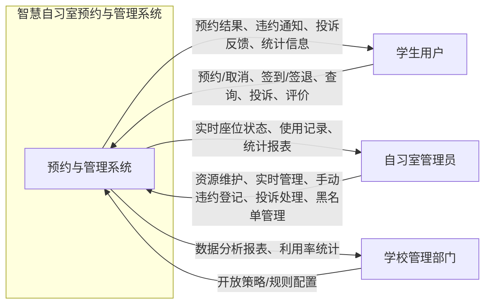

# 项目概述

> 应能够查到的内容：问题、业务目标、成功指标、涉众、确认责任、系统范围和非目标
> 推荐表示形式：简短文字、目标表、上下文图

## 1. 问题（Problem Statement）

随着高校学生自习需求的持续增长，传统自习室管理方式暴露出以下突出问题：

1. **座位资源信息不透明**：学生无法提前获知自习室座位占用情况，需要到现场"找座"，高峰时段常出现"空占座、真人无座"的资源浪费现象。
2. **预约流程缺失**：缺乏统一的线上预约渠道，座位使用靠排队、占座等无序方式分配，易引发同学间的矛盾。
3. **违约行为缺乏约束**：预约后不到场、签退后滞留、长时间占座离开等行为没有系统化的记录与惩戒机制，座位周转率低。
4. **管理手段低效**：管理员依赖人工巡查登记座位使用情况，工作量大、时效性差，难以实时掌握各自习室的运行状态。
5. **缺乏数据支撑决策**：座位利用率、违约率、高峰时段分布等数据未被采集与分析，学校无法依据数据优化自习室开放策略与资源配置。
6. **投诉反馈渠道不畅**：学生对设施故障、占座行为等的投诉缺乏统一的提交与处理闭环，管理方也缺少对管理人员服务质量的评价机制。

**一句话概括**：本系统旨在通过线上化、智能化的预约与管理手段，解决高校自习室"座位资源分配不均、违约无约束、管理低效、决策无数据"的问题。

## 2. 业务目标（Business Objectives）

本系统面向高校自习室场景，构建覆盖"预约—签到—使用—签退—评价"全流程的智慧化管理平台，并辅以违约治理、投诉闭环与数据可视化分析。

| 编号 | 业务目标 | 说明 | 优先级 |
|------|----------|------|--------|
| BO-1 | 实现自习室座位资源的统一线上管理 | 管理员可维护自习室与座位的属性信息（位置、类型、设施、状态等），实现资源数字化 | 高 |
| BO-2 | 提供便捷的预约与取消预约服务 | 学生可按日期、时段、自习室查询并预约座位，支持在规定时间内取消预约 | 高 |
| BO-3 | 建立签到/签退与自动违约机制 | 通过签到签退核验实际使用，系统自动记录超时未签到、未签退等违约行为 | 高 |
| BO-4 | 提供多维度查询能力 | 支持预约记录、座位实时状态、个人违规记录等查询 | 高 |
| BO-5 | 支持管理员实时座位管理与手动违约登记 | 管理员可查看实时座位使用情况、查看座位使用预约记录、手动登记现场违规行为 | 高 |
| BO-6 | 建立用户管理与信用治理体系 | 用户信息管理、评价管理、投诉管理与反馈、黑名单管理（多次违约用户限制预约） | 中 |
| BO-7 | 提供数据分析与可视化 | 柱状图、折线图等多形式统计展示（利用率、违约趋势、高峰时段等），每 10 秒自动刷新 | 中 |
| BO-8 | 提升座位资源利用率与管理效率 | 通过上述机制减少空占、提高周转率、降低人工管理成本 | 高 |

## 3. 成功指标（Success Metrics）

| 指标 | 度量方式 | 目标值（示例） |
|------|----------|----------------|
| 座位资源利用率 | 已使用座位时长 / 可用座位总时长 | 较上线前提升 20% 以上 |
| 预约履约率 | 正常签到完成的预约数 / 总预约数 | ≥ 90% |
| 违约率下降 | 违约记录数 / 预约总数 | 系统运行一个学期后下降 30% |
| 高峰时段"到场无座"投诉量 | 投诉记录中相关类别数量 | 显著下降 |
| 管理人工成本 | 管理员日均巡查登记耗时 | 降低 50% 以上 |
| 数据刷新时效 | 统计页面自动刷新间隔 | 10 秒 |
| 用户满意度 | 学生对自习室管理服务的评价得分 | ≥ 4.0 / 5.0 |

## 4. 涉众（Stakeholders）

| 涉众 | 角色/关切点 |
|------|-------------|
| **学生（普通用户）** | 核心使用者。希望便捷预约、查询座位、按时签到签退、查看与申诉自己的违规记录、提交投诉、对服务进行评价 |
| **自习室管理员** | 日常运营者。需要维护自习室与座位信息、实时监控座位状态、手动登记违约、处理投诉与反馈、管理黑名单、查看统计报表 |
| **学校（教务/后勤管理部门）** | 资源拥有者与决策方。关注资源利用率、管理成本、学生满意度，依据系统数据制定开放策略 |
| **开发与运维团队** | 系统的建设与维护方。关注系统稳定性、可扩展性与可维护性 |
| **监管与合规方（如学籍/学生工作部门）** | 关注黑名单等信用治理措施的公平性与合规性，以及学生个人信息的保护 |

## 5. 确认责任（Confirmation Responsibilities）

| 确认事项 | 责任方 | 确认方式 |
|----------|--------|----------|
| 业务目标与成功指标的合理性 | 学校管理部门 + 项目负责人 | 需求评审会签字确认 |
| 预约规则（时段划分、取消时限、违约判定规则、黑名单阈值） | 学校管理部门 + 自习室管理员 | 规则说明书评审确认 |
| 功能范围与非目标边界 | 项目负责人 + 开发团队 + 用户代表 | 需求规格说明书评审确认 |
| 涉众满意度指标与评价体系 | 学生代表 + 学校管理部门 | 问卷/评审确认 |
| 系统验收 | 学校管理部门 + 自习室管理员 + 开发团队 | 按验收用例进行验收测试 |

## 6. 系统范围（System Scope）

### 6.1 范围内（In Scope）

1. **自习室（座位）资源管理**：自习室信息、座位属性（编号、类型、电源/隔间等设施、状态：可用/维护中/停用）的增删改查。
2. **预约管理**：用户端与管理员端的预约、取消预约；时段与容量冲突校验。
3. **签到与签退**：预约时段内签到核验、使用结束签退；超时未签到、提前/超时离开等自动违约判定与记录。
4. **查询功能**：预约查询、座位实时状态查询、违规记录查询、座位使用预约记录查询。
5. **管理员实时管理**：实时座位状态大屏/列表、手动违约登记。
6. **用户管理**：用户信息管理、评价管理（对管理服务的评价）。
7. **投诉管理**：用户投诉提交、管理员处理与反馈信息推送。
8. **黑名单管理**：违约累计达到阈值的用户自动/手动加入黑名单，限制其预约权限。
9. **数据分析**：柱状图、折线图、统计数据展示（利用率、违约趋势、时段分布等），每 10 秒自动刷新。

### 6.2 上下文图（Context Diagram）

### 6.3 非目标（Out of Scope / Non-Goals）

以下内容明确不在本期系统范围内：

1. **硬件集成**：不接入门禁闸机、智能座位传感器、摄像头等物联网设备，签到签退通过系统操作完成（不做物理身份核验）。
2. **支付功能**：不提供在线付费预约、押金收取或退款功能。
3. **统一身份认证集成**：暂不对接学校统一身份认证（CAS/OAuth）系统，采用本系统独立账号体系。
4. **多校区/跨校推广**：本期仅面向单一校区的一处或多处自习室，不考虑多校区统一平台。
5. **移动端原生 App**：不开发原生 App，仅提供 Web 端（自适应页面）。
6. **智能推荐与预测**：不提供基于 AI 的座位推荐、人流预测等智能算法功能（数据分析仅限统计展示）。
7. **消息推送渠道集成**：不对接短信/微信公众号等外部通知渠道，通知仅在系统内展示。
8. **设施运维管理**：不管理空调、照明、消防等楼宇设备的运维工单。
