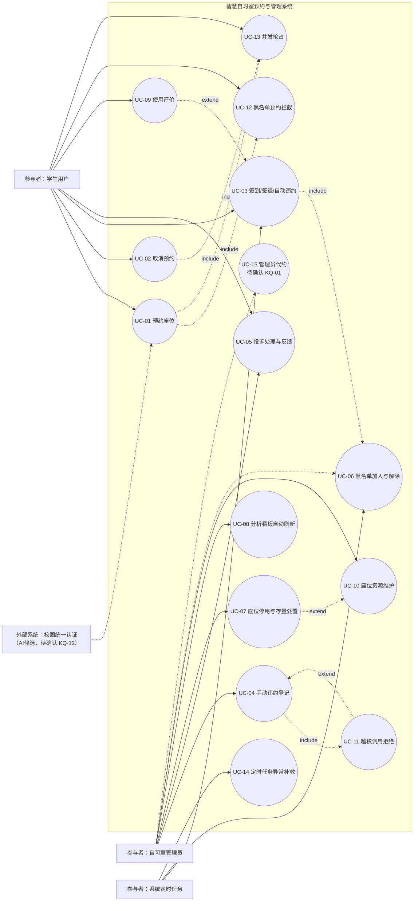

# 用户需求

## 1. 用户故事清单

### 1.1 角色

| 角色 | 说明 | 来源 |
|---|---|---|
| 学生用户 | 使用自习室座位的在校学生，通过浏览器自助预约、签到、签退、查询、评价、投诉 | 原文（"用户"）＋推导 |
| 自习室管理员 | 负责自习室日常运营的人员，维护座位资源、监控实时状态、登记违约、处理投诉与黑名单、查看分析 | 原文（"管理员"）＋推导 |
| 系统定时任务 | 非人类执行者，由系统调度：自动违约判定、黑名单自动加入与期满解除、通知推送 | 原文（"自动违约记录"）＋推导 |
| 外部身份服务 | 校园统一认证等外部系统（AI 候选，是否接入见 KQ-12） | AI 候选 |

> 管理员与学生在系统中是同一张用户表的两个角色，以权限区分，具体见"规则与权限"章节的权限矩阵。

### 1.2 学生用户故事

| 编号 | 用户故事 | 优先级 | 来源 | 关联功能 |
|---|---|---|---|---|
| US-01 | 作为学生，我希望按日期、时段、自习室、区域和座位属性筛选可用座位，以便快速找到符合条件的自习位置。 | 基本 | 原文-4（座位查询）＋AI 候选（属性筛选） | FR-04、FR-07 |
| US-02 | 作为学生，我希望选定座位和时间段后**一步完成预约**，不用反复跳转页面，以免因操作繁琐而放弃使用系统。 | 基本 | 原文-3（预约）＋草稿（预约方便） | FR-08 |
| US-03 | 作为学生，我希望在临时有事时**在允许的时限内取消预约**，且取消后座位立即释放给别人，以免误约长期占用资源。 | 基本 | 原文-3（取消预约）＋草稿（取消方便） | FR-09 |
| US-04 | 作为学生，我希望**签到入口在签到时间窗口内自动出现并可一键签到**，以免因找不到入口而错过签到被记违约。 | 基本 | 原文-3（签到）＋推导 | FR-10 |
| US-05 | 作为学生，我希望提前离开时能**签退并立即释放座位**，以便把剩余时段让给其他同学。 | 基本 | 原文-3（签退）＋推导 | FR-11 |
| US-06 | 作为学生，我希望查看本人的全部预约（含历史）及其状态，以便确认自己的预约是否有效。 | 基本 | 原文-4（预约查询） | FR-14 |
| US-07 | 作为学生，我希望查看本人的违约记录（时间、类型、原因），以便知道为什么被记违约。 | 基本 | 原文-4（违规记录查询） | FR-16 |
| US-08 | 作为学生，我希望看到自己的违约累计次数和是否被加入黑名单、何时解除，以便提前调整使用习惯。 | 期望 | 原文-6（违规记录查询的可视化）＋AI 候选（黑名单状态自助查询） | FR-16、FR-23 |
| US-09 | 作为学生，我希望使用结束后对座位环境和服务进行评价，以便把使用体验反馈给管理方。 | 期望 | 原文-6（评价管理） | FR-24 |
| US-10 | 作为学生，我希望在遇到违规判定有误、他人占座或设施故障时提交投诉，并且**能跟踪投诉的处理进度和结果**。 | 基本（提交）／期望（跟踪） | 原文-6（投诉管理、投诉反馈） | FR-25、FR-26 |
| US-11 | 作为学生，我希望签退时**顺带一键提交评价**，而不是事后专门找一个入口，以免因操作麻烦而放弃评价。 | 兴奋 | AI 候选 | FR-24 |
| US-12 | 作为学生，我希望在座位被管理员停用、预约被取消或即将违约时**收到提醒**，以免到了自习室才发现座位不可用。 | 期望 | AI 候选（原文未要求通知机制） | FR-35、FR-06 |
| US-13 | 作为学生，我希望**到馆扫码或定位即可完成签到**，不必手动点开预约单。 | 兴奋 | AI 候选 | FR-10 |
| US-26 | 作为学生，我希望系统根据我的常用时段和偏好**推荐合适的座位**，以免每次都要重新筛选。 | 兴奋 | AI 候选 | 无（本期不做，见 §3.2） |

### 1.3 自习室管理员用户故事

| 编号 | 用户故事 | 优先级 | 来源 | 关联功能 |
|---|---|---|---|---|
| US-14 | 作为管理员，我希望维护自习室信息（名称、位置、开放时间、座位规模），以便座位资源与实际场地一致。 | 基本 | 原文-1 | FR-01 |
| US-15 | 作为管理员，我希望逐个或批量维护座位编号、区域和属性标签，并能**停用故障座位**，以免学生预约到不可用的座位。 | 基本 | 原文-1 | FR-02、FR-03 |
| US-16 | 作为管理员，我希望在**一张看板上实时看到全部座位的占用情况**，并能对违规使用快速登记违约，以便及时释放被占用的资源。 | 基本 | 原文-5（实时座位管理、手动违约登记）＋草稿（管理座位方便、及时处理违约） | FR-18、FR-19 |
| US-17 | 作为管理员，我希望查询某个座位或某个时段的使用与预约记录，以便复盘争议、回应投诉。 | 基本 | 原文-5（座位使用预约记录） | FR-17 |
| US-18 | 作为管理员，我希望集中处理学生投诉、填写处理结果并**自动把结果反馈给学生**，以免投诉积压。 | 基本 | 原文-6（投诉管理、投诉反馈） | FR-27 |
| US-19 | 作为管理员，我希望查看黑名单并处理被误判用户的申诉、提前解除限制，以便保留人工纠错通道。 | 期望 | 原文-6（黑名单管理）＋AI 候选（申诉） | FR-29、FR-30 |
| US-20 | 作为管理员，我希望查看使用率、预约量、违约率和投诉量的柱状图与折线图，并且**数据自动刷新**，以便随时掌握运营状况而不用手动刷新。 | 期望 | 原文-7（数据分析、每 10 秒自动刷新） | FR-31～FR-33 |
| US-21 | 作为管理员，我希望维护用户账户信息（并删除违规评价），以便处理恶意使用与不当言论。 | 基本 | 原文-6 | FR-21、FR-24 |
| US-22 | 作为管理员，我希望**导出席位使用统计报表**，以便向院系或后勤提交月度使用报告。 | 兴奋 | AI 候选 | FR-34 |

### 1.4 系统定时任务（非人类执行者）用户故事

| 编号 | 用户故事 | 优先级 | 来源 | 关联功能 |
|---|---|---|---|---|
| US-23 | 作为系统，我需要在学生超过签到时限仍未签到时自动判定违约并记录，**且同一预约只判定一次**。 | 基本 | 原文-3（自动违约记录） | FR-12 |
| US-24 | 作为系统，我需要在用户违约累计达到阈值时自动加入黑名单、期满自动解除，并通知本人。 | 基本 | 原文-6（黑名单管理） | FR-28、FR-30 |
| US-25 | 作为系统，我需要在预约即将开始、违约判定、投诉反馈、座位停用等时点向相关用户推送站内通知。 | 期望 | AI 候选 | FR-35 |

### 1.5 原始草稿与本文的对应

草稿中的两条故事已被展开为更具体、可验收的故事，对应关系如下：

| 草稿原文 | 展开结果 |
|---|---|
| "作为学生希望预约与取消方便" | 拆成 US-01～US-05：方便体现在**筛选准、一步预约、签到入口自动出现、取消有明确时限且即时释放**四个可检验点上 |
| "作为管理员希望管理座位方便及时处理违约情况" | 拆成 US-15～US-17：用"实时看板＋快速登记违约＋记录可追溯"替代笼统的"方便" |

---

## 2. 优先级

### 2.1 优先级口径

按 Kano 模型把需求分为基本需求、期望性需求、兴奋性需求，并叠加"课程必做范围"这一外部约束：

| 优先级 | 含义 | 排序处理 |
|---|---|---|
| **基本** | 不满足则系统无法完成核心业务闭环，用户会直接无法使用 | 必须在本期完成，全部列入需求清单 |
| **期望** | 做得越好用户越满意，做得差会明显降低满意度 | 本期完成，若进度紧张可先简化为可接受的最低实现 |
| **兴奋** | 用户未明确期待、出现会带来惊喜，缺失不影响正常使用 | 本期不承诺，列入后续迭代 |

**必做范围判定**：任务原文的 7 条核心功能全部列入"基本"或"期望"，不得裁剪；AI 候选功能一律不高于"期望"，且不得与原文功能争夺本期资源。每个 Basic/期望项都对应一条"验收底线"：功能有数据留痕、状态流转正确、权限可拒绝。

### 2.2 功能优先级排序

| 排序 | 模块 | 功能编号 | 优先级 | 判定理由 |
|---|---|---|---|---|
| 1 | 座位资源 | FR-01、FR-02、FR-03 | 基本 | 无座位数据则预约无从谈起（原文-1） |
| 2 | 预约管理 | FR-07、FR-08、FR-09 | 基本 | 预约-取消闭环（原文-2、原文-3） |
| 3 | 预约管理 | FR-10、FR-11 | 基本 | 签到-签退闭环（原文-3） |
| 4 | 预约管理 | FR-12、FR-13 | 基本 | 自动违约与座位时段释放（原文-3） |
| 5 | 查询服务 | FR-14、FR-15、FR-16、FR-17 | 基本 | 原文-4 明列的三类查询＋原文-5 的座位记录 |
| 6 | 实时管理 | FR-18、FR-19 | 基本 | 人工兜底通道（原文-5） |
| 7 | 用户管理 | FR-21、FR-24（基础部分）、FR-25、FR-26、FR-27、FR-28、FR-29 | 基本 | 原文-6 的用户、评价、投诉、反馈、黑名单 |
| 8 | 数据分析 | FR-31、FR-32、FR-33 | 基本 | 原文-7 明确要求柱状图、折线图、统计及 10 秒刷新 |
| 9 | 用户管理 | FR-29、FR-30 | 期望 | 黑名单申诉与通知，纠错通道与透明度（原文-6 只要求"管理"，申诉为增强） |
| 10 | 查询服务 | FR-23 | 期望 | 黑名单状态自助查询，减少咨询量 |
| 11 | 系统协同 | FR-20、FR-35 | 期望 | 操作留痕与多类通知，提升可追溯性与透明度 |
| 12 | 用户管理 | FR-24（提交后修改/删除本人评价） | 期望 | 评价本身是基本项，修改是增强 |
| 13 | 数据分析 | FR-31、FR-32（下钻、多维筛选、时间范围对比） | 期望 | 图表本身是基本项，分析深度是加分项 |
| 14 | 预约管理 | FR-13（并发锁的实时占用提示） | 期望 | 基本要求是"不能重复占用"，实时锁是体验层面的强化 |
| 15 | 数据分析 | FR-34 | 兴奋 | 报表导出，用户未提出 |
| 16 | 预约管理 | UC-15 管理员代约（见 §7） | 待确认 | 任务原文"预约管理（用户、管理员）"存在两种读法，见 KQ-01 |

> 排序原则：同一优先级内按"是否处于核心闭环上"排；不在闭环上的查询、分析、管理功能排在闭环之后，但**不降低其必做地位**。

---

## 3. 功能范围

### 3.1 范围内功能（需求清单）

"来源"列用原文条目标号引用（对应 `熟悉业务系统项目 .md` 的 1～7 条与 PDF 第 9 节同名条目）。

| 编号 | 功能 | 来源 | 用户故事 | 优先级 | 备注 |
|---|---|---|---|---|---|
| FR-01 | 自习室信息维护：新增/修改/停用自习室，维护名称、位置、开放时间段、座位容量 | 原文-1 | US-14 | 基本 | 开放时间段决定可预约范围（BR-02） |
| FR-02 | 座位属性维护：座位编号、所属自习室、区域、属性标签（靠窗/有电源等），启用/停用 | 原文-1 | US-15 | 基本 | 停用联动见 FR-06 |
| FR-03 | 座位启用/停用与恢复 | 原文-1＋推导 | US-15 | 基本 | 状态机见"行为与状态"章节 |
| FR-04 | 座位状态查询：按时间维度展示各座位可预约/已预约/使用中/停用 | 原文-4（座位查询） | US-01 | 基本 | — |
| FR-05 | 座位可用性计算：给定日期与时段返回可用座位集合 | 推导 | US-01 | 基本 | 所有预约校验的唯一依据 |
| FR-06 | 停用座位时自动取消其未来未开始时段的预约并通知 | 推导 | US-12、US-15 | 基本 | 已开始/使用中的预约如何处理见 KQ-07 |
| FR-07 | 按日期、时段、自习室、区域、属性标签筛选可预约座位 | 原文-4＋AI 候选（筛选维度） | US-01 | 基本 | 筛选维度为 AI 候选 |
| FR-08 | 提交预约：选定座位与时段，校验后生成"待签到"预约单 | 原文-2、原文-3 | US-02 | 基本 | 核心用例 UC-01 |
| FR-09 | 取消预约：在允许时限内取消本人待签到预约，即时释放座位时段 | 原文-3 | US-03 | 基本 | 核心用例 UC-02 |
| FR-10 | 签到：在签到时间窗口内将预约单转为"已签到" | 原文-3 | US-04、US-13 | 基本 | 核心用例 UC-03 |
| FR-11 | 签退：结束使用，即时释放座位剩余时段 | 原文-3 | US-05 | 基本 | 核心用例 UC-03 |
| FR-12 | 自动违约判定：超过签到时限未签到时由定时任务判违约、写记录、释放座位 | 原文-3 | US-23 | 基本 | 核心用例 UC-03 |
| FR-13 | 座位时段占用控制：同一座位同一时段至多一个有效预约；并发提交时只有一方成功 | 推导 | US-02 | 基本（并发锁为期望） | 并发锁实现见 KQ-02 |
| FR-14 | 我的预约查询：本人预约列表（含历史）及明细 | 原文-4 | US-06 | 基本 | 筛选条件见 FR-15 |
| FR-15 | 预约检索：学生按状态/日期筛选本人预约；管理员按用户、座位、自习室、时间段、状态多条件检索其数据范围内的预约 | 原文-4、原文-5 | US-06、US-17 | 期望 | 管理员"座位使用预约记录"的入口 |
| FR-16 | 违规记录查询：本人违约记录及累计次数、黑名单状态；管理员按用户/时间段检索全部 | 原文-4 | US-07、US-08 | 基本 | — |
| FR-17 | 座位使用与预约记录：按座位/时间段查看使用记录与预约记录 | 原文-5 | US-17 | 基本 | — |
| FR-18 | 实时座位看板：按自习室展示全部座位当前状态 | 原文-5 | US-16 | 基本 | 刷新周期见 KQ-06 |
| FR-19 | 手动违约登记：对"已签到"预约登记违约，必填原因，写入违约记录并释放座位 | 原文-5 | US-16 | 基本 | 核心用例 UC-04 |
| FR-20 | 敏感操作留痕：违约登记、投诉处理、黑名单加入/解除记录操作人、时间、原因 | 推导 | US-16、US-18、US-19 | 期望 | 与 NFR-06 对应 |
| FR-21 | 用户信息管理：学生维护本人基本信息；管理员查询用户账户、预约、违约概况并维护账户状态 | 原文-6 | US-21 | 基本 | — |
| FR-22 | 用户账户状态维护（启用/停用） | 原文-6＋推导 | US-21 | 基本 | 与黑名单（FR-28）是不同概念，见 KQ-05 |
| FR-23 | 本人黑名单状态查询：当前是否受限、限制起止时间、触发原因 | AI 候选 | US-08 | 期望 | 原文只要求"违规记录查询"，黑名单状态自助查询为补充 |
| FR-24 | 评价管理：签退后对本次使用评分和提交文字评价，每人每预约单 1 条；管理员删除违规评价 | 原文-6 | US-09、US-11、US-21 | 基本（签退后评价）；修改或删除评价为期望 | 核心用例 UC-06 |
| FR-25 | 投诉提交：针对座位设施、占座行为、违约判定、评价不当等对象提交投诉 | 原文-6 | US-10 | 基本 | 对象类型为 AI 候选 |
| FR-26 | 投诉进度查询：查看本人投诉及处理状态、处理结果 | 原文-6（投诉反馈信息） | US-10 | 基本 | 核心用例 UC-05 |
| FR-27 | 投诉处理与反馈：管理员受理、处理、填写结果，系统把结果反馈给投诉人 | 原文-6 | US-18 | 基本 | 核心用例 UC-05 |
| FR-28 | 黑名单管理：按阈值自动加入、期满自动解除、限制期内禁止新预约 | 原文-6 | US-24 | 基本 | 核心用例 UC-06 与"黑名单"UC-07 |
| FR-29 | 黑名单查询与人工解除：管理员查看黑名单、处理申诉、提前解除 | 原文-6＋AI 候选（申诉） | US-19 | 期望 | — |
| FR-30 | 黑名单自动加入/解除的结果通知（站内 + 邮件，渠道见 KQ-11） | AI 候选 | US-24 | 期望 | — |
| FR-31 | 柱状图分析：按自习室使用率对比、按时段使用量分布 | 原文-7 | US-20 | 基本（图表）＋期望（筛选/下钻） | — |
| FR-32 | 折线图分析：按日/周/月展示预约量、违约率、投诉量趋势 | 原文-7 | US-20 | 基本（图表）＋期望（时间范围对比） | — |
| FR-33 | 统计数据自动刷新：分析看板（含数据集）每 10 秒自动刷新，无需人工刷新 | 原文-7（每 10 秒） | US-20 | 基本 | 周期以原文 10 秒为准；实时看板是否同样刷新见 KQ-06 |
| FR-34 | 统计报表导出 | AI 候选 | US-22 | 兴奋 | 不承诺本期 |
| FR-35 | 站内通知中心：预约开始前提醒、预约成功/取消、违约、黑名单变动、投诉反馈、座位停用通知 | AI 候选 | US-12、US-25 | 期望 | 原文要求"投诉反馈信息"（FR-27），其余通知类型为补充；渠道见 KQ-11 |

### 3.2 范围外事项

以下内容**本期不做**，用于界定边界（均为 AI 候选，需在后续章节确认；确认前不得纳入需求清单）：

- 门禁闸机、人脸识别等硬件联动控制；
- 座位使用收费与结算；
- 跨校区多校园统一平台；
- 基于 AI 的个性化座位推荐算法；
- 移动端原生 App（只要求浏览器可访问）。

---

## 4. 关键用例

### 4.1 用例清单与场景排序

按**主场景 → 可能场景 → 异常场景**排序。"类型"列说明该用例属于哪一类业务闭环，便于识别代表性。

| 编号 | 用例名称 | 参与者 | 类型 | 优先级 | 频率口径 | 频率来源 |
|---|---|---|---|---|---|---|
| UC-01 | 预约座位 | 学生 | 主场景（资源分配闭环起点） | 基本 | 高频：与每日自习人次同量级，是全系统触发最多的写操作 | **待确认**（见 §6.1） |
| UC-02 | 取消预约 | 学生 | 主场景（资源回收） | 基本 | 中频：低于预约量，取决于用户临时变更行程的比例 | **待确认** |
| UC-03 | 签到 / 签退 / 自动违约判定 | 学生；系统定时任务 | 主场景＋异常（到馆履约闭环） | 基本 | 签到与签退高频（≈预约量）；自动违约的中频量取决于爽约率，定时任务本身为固定周期触发 | **待确认** |
| UC-04 | 实时座位监控与手动违约登记 | 管理员 | 可能场景（人工兜底） | 基本 | 低频：每当发现违规占用时才发生 | **待确认** |
| UC-05 | 投诉提交与处理反馈 | 学生；管理员 | 可能场景（服务补救闭环） | 基本 | 低频：相对预约量明显更低 | **待确认** |
| UC-06 | 违约累计与黑名单加入/解除 | 系统定时任务；管理员 | 可能场景（约束闭环） | 基本 | 低频：与违约次数和阈值同量级；定时任务固定周期 | **待确认** |
| UC-07 | 座位停用与存量预约处置 | 管理员 | 异常场景（资源失效处置） | 基本 | 低频：设备故障或场地调整时发生 | **待确认** |
| UC-08 | 分析看板查看与自动刷新 | 管理员 | 可能场景（运营观测） | 基本 | 视业务需要访问；自动刷新固定 10 秒（原文） | **待确认**（人工访问部分） |
| UC-09 | 使用评价提交与违规评价处理 | 学生；管理员 | 可能场景（质量反馈） | 基本 | 评价低频；违规评价删除极低频 | **待确认** |
| UC-10 | 座位资源维护 | 管理员 | 异常场景（结构性变更） | 基本 | 极低频：学期初或场地调整时发生 | **待确认** |
| UC-11 | 手动违约登记的越权与状态异常 | 学生/未知身份调用管理员接口 | 异常场景（权限拒绝） | 基本 | 取决于恶意尝试，无法预判 | **待确认** |
| UC-12 | 黑名单用户的预约拦截 | 学生 | 异常场景（约束生效） | 基本 | 与黑名单人数 × 尝试次数相关 | **待确认** |
| UC-13 | 并发抢占同一座位时段 | 多名学生 | 异常场景（并发冲突） | 基本 | 与热门时段集中度相关 | **待确认** |
| UC-14 | 定时任务异常与补救 | 系统运维 | 异常场景（可靠性） | 期望 | 无法预判 | **待确认** |
| UC-15 | 管理员代约 | 管理员 | 异常场景（是否允许待确认） | 待确认 | 未知，取决于是否纳入范围 | **待确认** |

### 4.2 关键用例选择说明

课程要求选 3—5 个有代表性、体现关键业务闭环的用例，而不是只选登录、查询。本文选 **UC-01、UC-03、UC-04、UC-05、UC-06、UC-09** 六个，略超建议数量，理由是本系统的核心闭环（履约、治理、服务、约束）分别由不同用例承载，删去任意一个都会留下覆盖缺口；如评审认为过多，可优先保留 UC-01、UC-03、UC-04、UC-06 四个。各用例的代表性如下：

| 入选用例 | 代表性 |
|---|---|
| UC-01 预约座位 | 带出全部前置校验规则（黑名单、时间窗、时段冲突、并发），是资源分配闭环的起点 |
| UC-03 签到 / 签退 / 自动违约 | 唯一跨越"学生主动操作 + 系统定时任务"两类执行者的用例，同时覆盖正常与超时异常 |
| UC-04 手动违约登记 | 管理员的唯一强制性操作，涉及权限、状态前置条件、留痕和申诉衔接 |
| UC-05 投诉提交与处理反馈 | 跨角色协作闭环，有超时、退回、重复提交等典型异常，并驱动通知 |
| UC-06 违约累计与黑名单 | 最能体现"计算规则 + 阈值 + 定时任务 + 人工纠错"的组合 |
| UC-09 使用评价 | 签退后的收尾闭环，含状态前置条件与管理员审核异常 |

其余用例（UC-07、UC-08、UC-10～UC-15）在 §7 以简表列出关键验收点，避免本文档只覆盖"简单功能"；UC-02 的完整流程同样在 §6 详细列出。

> 登录、注册属于所有用例的公共前置条件，本文只在一个用例（UC-01）的前置条件中说明，不单列为核心用例。UC-12（黑名单拦截）与 UC-13（并发抢占）分别在 UC-01 的异常分支中细化，不再单列。

---

## 5. 用例图

### 5.1 图 GM-04：系统用例图

- 编号与名称：GM-04 系统用例图
- 建模对象：系统级用例与参与者关系
- 关联需求：FR-01～FR-35；关联用例：UC-01～UC-15
- 可编辑源文件：`docs/diagrams/GM-04-用例图.mmd`
- 图形导出：需由小组在支持 Mermaid 的工具中导出 PNG/SVG/PDF 后作为附件提交（`.mmd` 是可编辑源文件，不能代替清晰导出）

图注说明：

1. 实线箭头表示参与者与用例的关联，虚线箭头表示参与者或外部系统的次要交互，`include`/`extend` 按 UML 语义绘制；绘图工具若仅支持流程图（如 Mermaid），应在导出时说明这是用例关系示意图，并在导出图中保留上述文字标注。
2. 引入外部身份服务（虚线）只是为了标记候选外部依赖，未确认接入前不得在需求中写成已实现。
3. 管理员与 UC-06 之间为虚线，表示管理员只能**查看和提前解除**，加入由系统判定。
4. UC-11、UC-12、UC-13、UC-14 是异常场景用例，不与主场景并列作为"正常功能"呈现。
5. 图内所有命名与 §4.1、§6、§7 一致；如后续修改用例名称，须同步更新本图、用户故事和权限矩阵。

### 5.2 图与文字的一致性检查项

- [ ] 图中的用例编号都能在 §4.1 找到；
- [ ] §4.1 中的每个用例都在图中出现（或明确标为"未在图中体现的扩展点"）；
- [ ] 角色名称与 §1.1 一致；
- [ ] 图中的 `include`/`extend` 关系与 §6、§7 中用例的"关联规则/关键验收点"一致；
- [ ] 所有"待确认"标记都能在 §9 找到对应 KQ 编号。

---

## 6. 详细用例表

每个用例按统一模板填写：编号与名称、参与者、触发事件、前置条件、主流程、替代及异常流程、成功与失败后的结果、关联规则、验收标准、预期使用频率或触发规律。

**频率口径**：所有频率项均标注"待确认"，并给出后续量化所需的计算口径（由哪个原始数据、哪条任务原文决定量级），不填具体数字。

### 6.1 UC-01 预约座位

| 项目 | 内容 |
|---|---|
| 编号与名称 | UC-01 预约座位 |
| 参与者 | 主参与者：学生用户；辅助参与者：系统定时任务（仅参与失败后的资源回收，见 UC-03） |
| 触发事件 | 学生在查询到可用座位后点击"预约"，或在座位详情页选择时段后提交 |
| 前置条件 | ① 学生已通过身份认证并登录；② 账户状态为"正常"、不在黑名单有效期内；③ 目标日期在可预约时间窗内；④ 目标座位处于启用状态、所属自习室处于开放状态；⑤ 目标座位在该时段未被占用 |
| 主流程 | 1. 学生选择日期、时段，系统按 FR-05 计算可用座位集合并展示（FR-07）。 2. 学生选定一个座位，系统展示该座位信息及该时段是否可约。 3. 学生确认提交。 4. 系统依次校验：黑名单状态（BR-07）→ 预约时间窗（BR-01、BR-02）→ 本人有效预约重叠（BR-03）→ 座位时段占用（BR-04）→ 并发锁（FR-13）。 5. 全部通过后生成"待签到"状态的预约单，座位该时段转为"已预约"，返回预约单号与时段信息。 6. 系统向学生推送站内预约成功通知（FR-35）。 |
| 替代流程 | 3a. 学生在提交前改选其他座位或时段，回到第 2 步，不产生任何数据。 4a. 学生申请预约的时间段跨越多个 1 小时单元：系统按 BR-01 拆分为连续的多段并作为一个预约单处理（BR-06）。 4b. 目标时段仅剩部分可用：系统按 BR-06 允许"非整点剩余时段"，并在第 2 步提示可约的实际起止时间。 5a. 学生已有一个"待签到"预约且时段相邻但不重叠：允许提交（BR-03 只禁止重叠）。 |
| 异常流程 | 4a. 学生在黑名单有效期内：拒绝，提示限制截止日期与当前违约累计；不生成预约单，不占用座位（跳转 UC-12）。 4b. 超过可预约时间窗（如超出自习室开放时间或早于系统当前时间）：拒绝并提示允许范围。 4c. 与本人已有有效预约时段重叠：拒绝并列出冲突的预约单编号。 4d. 座位已被他人预约（含刚刚被抢占）：拒绝并提示"该时段已被占用"，引导重新选择（跳转 UC-13）。 4e. 座位或自习室在提交瞬间被管理员停用：拒绝并提示座位不可用（UC-07）。 4f. 请求未携带有效令牌或令牌过期：拒绝并要求重新登录（UC-11）。 |
| 成功后的结果 | 新增 1 条"待签到"预约单；该座位在该时段的状态由"空闲"转为"已预约"；产生预约成功通知；预约记录进入 FR-15 的检索范围 |
| 失败后的结果 | 不生成预约单；座位时段状态保持"空闲"；用户已有预约与违约计数不变；返回明确拒绝原因（对应 code） |
| 关联规则 | BR-01、BR-02、BR-03、BR-04、BR-06、BR-07；状态转换 ST-01（预约单）、ST-08（座位时段）；权限：仅学生本人可发起，管理员默认不可代约（KQ-01） |
| 验收标准 | ① 满足全部前置条件时，提交后 1 秒内（指标待确认，见 NFR-01）返回预约单号，`我的预约` 中状态为"待签到"。 ② 黑名单用户提交时返回"限制预约"错误码，数据库中预约表记录数不变。 ③ 同一学生连续提交两个重叠时段，第二次被拒绝且提示冲突单号。 ④ 两名学生同时对同一座位同一时段提交，仅一方成功，另一方收到"已被占用"，座位表只存在一条有效预约。 ⑤ 预约成功后，座位该时段状态为"已预约"，其他学生查询该时段时看不到该座位。 |
| 预期使用频率/触发规律 | **待确认。** 口径：每日预约量 ≈ 在校学生数 × 每日使用自习室比例 × 人均每日预约次数；量级判断依据是原文-2、原文-3 把预约与签到列为系统主流程。峰值规律（考试周、晚间时段集中）也**待确认**，需采集历史使用记录。 |

### 6.2 UC-02 取消预约

| 项目 | 内容 |
|---|---|
| 编号与名称 | UC-02 取消预约 |
| 参与者 | 学生用户 |
| 触发事件 | 学生在"我的预约"列表中点击"取消"，或从预约详情页发起取消 |
| 前置条件 | ① 学生已登录；② 存在本人名下"待签到"状态的预约单；③ 距离预约开始时间满足取消时限（BR-05） |
| 主流程 | 1. 学生打开"我的预约"，系统列出本人预约单及状态。 2. 学生选择一条"待签到"预约单并点击取消。 3. 系统校验预约单归属、状态与取消时限（BR-05）。 4. 校验通过后预约单转为"已取消"，该座位对应时段释放为"空闲"。 5. 系统向学生推送取消成功通知（FR-35）。 |
| 替代流程 | 2a. 学生取消后立即重新预约同一座位同一时段：按 UC-01 重新走完整校验，原预约单不得被"复活"。 3a. 学生提前很久取消（远大于时限）：同样允许，不额外限制次数（当前无取消次数上限规则，见 KQ-08）。 |
| 异常流程 | 3a. 不足最小取消时限：拒绝，提示"距开始不足 X 分钟不可取消"及具体可取消截止时间；预约单保持"待签到"。 3b. 预约单状态为"已签到"或"已违约"或"已取消"：拒绝并提示当前状态（取消是"待签到"专属操作）。 3c. 预约单不属于当前登录用户：拒绝并按越权处理（UC-11）。 3d. 预约单已被系统自动违约（定时任务恰好触发）：拒绝，提示已被判定违约。 |
| 成功后的结果 | 预约单状态"待签到 → 已取消"；座位时段"已预约 → 空闲"；产生取消通知；该预约单不再可被签到 |
| 失败后的结果 | 预约单与座位状态均保持原值；不产生新记录；不产生通知 |
| 关联规则 | BR-05（取消时限）、BR-04（时段占用释放）；状态转换 ST-02（预约单）、ST-09（座位时段）；权限：仅本人可取消本人预约 |
| 验收标准 | ① 距离开始刚好等于取消时限时允许取消（边界闭合方向待小组确认）。 ② 预约单在取消截止时间之后提交取消请求，返回拒绝且状态仍为"待签到"。 ③ 取消成功后，其他学生能在同一时段预约该座位。 ④ 取消后再次尝试签到该预约单，返回状态非法错误。 ⑤ 他人取消他人预约的请求被拒绝，且预约单状态不变。 |
| 预期使用频率/触发规律 | **待确认。** 口径：取消量 ÷ 预约量 = 临时变更率；量级低于预约量，具体比例需上线后统计。时间分布预期集中在预约开始前数小时，**待确认**。 |

### 6.3 UC-03 签到 / 签退 / 自动违约判定

| 项目 | 内容 |
|---|---|
| 编号与名称 | UC-03 签到、签退与自动违约判定 |
| 参与者 | 主参与者：学生用户（签到、签退）；系统定时任务（自动违约判定） |
| 触发事件 | 签到：学生进入"我的预约"点击签到，或扫码/定位触发（FR-10 扩展，AI 候选）。 签退：学生结束使用点击签退。 自动违约：系统定时任务按固定周期扫描"待签到"的过期预约单。 |
| 前置条件 | 签到：① 学生已登录；② 预约单属于本人且状态为"待签到"；③ 当前时间处于签到时间窗口内（BR-08 前半段）。 签退：① 预约单属于本人且状态为"已签到"。 自动违约：① 预约单状态为"待签到"；② 当前时间已越过签到截止时间（BR-08 后半段）；③ 系统时间与服务器一致（AS-03）。 |
| 主流程 | 签到： 1. 学生从"我的预约"进入待签到预约单。 2. 系统按当前时间判断并展示签到按钮是否可用。 3. 学生点击签到。 4. 系统校验归属、状态、时间窗口。 5. 校验通过，预约单转为"已签到"，座位转为"使用中"，返回签到成功。 签退： 6. 学生结束使用，点击签退。 7. 系统校验归属与状态。 8. 预约单转为"已签退"，座位自签退时刻起的剩余时段释放为"空闲"（BR-09），返回签退成功。 自动违约： 9. 定时任务按周期查询已过签到截止时间仍为"待签到"的预约单。 10. 对每一条：预约单转为"已违约"，生成 1 条"自动违约"记录（含判定时间与依据），座位该时段释放。 11. 触发违约计数与黑名单判断（UC-06），并向学生推送违约通知。 |
| 替代流程 | 1a. 当前时间早于签到窗口：显示"签到将于 HH:mm 开放"，按钮置灰。 4a. 学生在窗口内重复点击签到：第二次请求按幂等处理，返回已签到结果，不重复变更状态。 8a. 学生提前签退：允许，剩余时段立即释放（BR-09）。 8b. 学生使用到时段自然结束仍未签退：预约单状态处理见 KQ-03（候选：结束后自动置为"已签退"）。 10a. 同一预约单被多个扫描周期命中：以"待签到 → 已违约"的状态前置条件保证只判定一次（幂等）。 |
| 异常流程 | 4a. 学生不在签到时间窗口内签到（过早或超过截止）：拒绝并提示窗口起止时间，状态保持"待签到"。 4b. 学生签到时预约单已被自动违约：拒绝，提示"已超时违约"。 4c. 预约单不属于本人：拒绝并按越权处理。 4d. 学生使用他人设备扫码或重复账号登录：以登录身份与预约单归属不一致为由拒绝。 7a. 签退时预约单未处于"已签到"（如已被管理员登记违约）：拒绝并提示当前状态。 9a. 定时任务执行异常中断：记录失败日志并进入重试，未扫描的预约单在下次扫描继续处理，不得重复判定（UC-14）。 |
| 成功后的结果 | 签到：预约单"已签到"、座位"使用中"、可签退。 签退：预约单"已签退"、座位剩余时段"空闲"、可评价（BR-10 / UC-09）。 自动违约：预约单"已违约"、新增 1 条违约记录、座位时段回收、违约计数 +1、产生违约通知 |
| 失败后的结果 | 签到失败：预约单保持"待签到"，座位保持"已预约"，签到时间字段保持为空。 签退失败：预约单保持"已签到"，座位保持"使用中"。 自动违约失败：预约单保持"待签到"，不产生违约记录，待下次扫描重试，不出现"半完成"状态 |
| 关联规则 | BR-08（签到窗口）、BR-09（签退释放）、BR-07（违约计数）、BR-10（评价前置）；状态转换 ST-03（签到）、ST-04（签退）、ST-05（自动违约）、ST-10/ST-11（座位）；权限：本人签到签退；定时任务代替用户执行违约判定，不可越权修改预约时段 |
| 验收标准 | ① 签到窗口起点前一分钟签到被拒绝，窗口内签到成功；截止后一分钟签到被拒绝且状态为"已违约"。 ② 连续两次签到请求只产生 1 次状态变更，签到时间不被第二次请求覆盖。 ③ 签退成功后，同一时段剩余时间可被其他学生预约。 ④ 自动违约任务重复运行两次，违约记录仍只有 1 条。 ⑤ 自动违约后学生仍能在"违规记录"中看到该记录及判定时间。 |
| 预期使用频率/触发规律 | **待确认。** 签到频率接近 UC-01 的预约量；签退频率接近签到量；自动违约量 = 预约量 × 爽约率，爽约率**待确认**。定时任务扫描周期（候选：1 分钟，见 KQ-06）**待确认**。 |

### 6.4 UC-04 实时座位监控与手动违约登记

| 项目 | 内容 |
|---|---|
| 编号与名称 | UC-04 手动违约登记（含实时座位看板定位） |
| 参与者 | 自习室管理员 |
| 触发事件 | 管理员在实时座位看板（FR-18）上发现某"使用中"座位实际无人或存在违规使用（长时间占座、代占、非本人使用等），点击该座位登记违约 |
| 前置条件 | ① 管理员已登录并具有座位管理与违约登记权限（权限矩阵见"规则与权限"章节）；② 目标预约单处于"已签到"状态；③ 管理员已根据现场巡查确认违规事实（人工判断，须填写原因） |
| 主流程 | 1. 管理员打开实时座位看板，按自习室查看座位状态（空闲/已预约/使用中/停用）。 2. 管理员定位到目标座位，点击进入座位详情，看到当前使用人的预约信息（仅展示处理违约所必要的信息）。 3. 管理员点击"登记违约"，填写违约原因（必填）并确认。 4. 系统校验权限、目标预约单状态（须为"已签到"）、原因非空。 5. 校验通过：预约单转为"已违约"，生成 1 条"手动违约"记录（含操作人、时间、原因），座位释放为"空闲"。 6. 系统向被登记学生推送违约通知，并触发违约计数与黑名单判断（UC-06）。 |
| 替代流程 | 3a. 管理员先查看该座位的预约与使用记录（FR-17）再决定是否登记，不登记时不产生任何数据。 4a. 管理员登记后学生提出申诉：走投诉流程（UC-05），申诉处理结果是否可撤销该条违约记录见 KQ-09（候选：不自动撤销，由管理员人工处理）。 |
| 异常流程 | 2a. 管理员无该自习室的数据范围权限（例如只被授权管理 A 栋却访问 B 栋）：拒绝，看板不展示该房间数据。 4a. 目标预约单不处于"已签到"（学生已签退、已取消或未签到）：拒绝登记、提示实际状态，预约单状态不变（状态保持）。 4b. 未填写原因或原因仅含空白字符：拒绝提交并提示必填。 4c. 该预约单已被本人取消（不应出现，因为已签到者不可取消）：拒绝并提示状态不一致。 4d. 管理员点击的是"空闲"座位：无违约对象，按钮不可用。 4e. 非管理员身份直接调用登记接口：拒绝并记录日志（UC-11）。 4f. 管理员重复点击提交：按幂等处理，只生成 1 条违约记录。 |
| 成功后的结果 | 新增 1 条手动违约记录（类型=手动，含原因与操作人）；预约单"已签到 → 已违约"；座位"使用中 → 空闲"；学生收到违约通知；违约计数 +1 |
| 失败后的结果 | 不生成违约记录；预约单与座位状态保持原值；不触发计数；返回明确拒绝原因 |
| 关联规则 | BR-07（违约计数）、BR-11（手动违约前置条件与必填原因）、BR-09（释放座位）、BR-12（留痕）；状态转换 ST-06（预约单）、ST-12（座位）；权限：仅管理员，数据范围见 PS-02 |
| 验收标准 | ① 对"已签到"预约登记违约成功，违规记录查询中能按学生查到类型为"手动"、含原因和操作人的记录。 ② 对"待签到"或"已签退"预约登记被拒绝，且预约状态未变。 ③ 原因为空时提交被拒绝。 ④ 学生身份调用登记接口返回 403，且数据库无新增记录。 ⑤ 登记后座位立即显示为"空闲"，可在该时段被其他学生预约。 ⑥ 同一操作重复提交两次，违约记录只有 1 条。 |
| 预期使用频率/触发规律 | **待确认。** 口径：手动违约量 = 巡查次数 × 每次发现违规的概率；属于低频事件，需结合管理员的巡查制度（巡查频次本身**待确认**）。看板访问频率与开放时段工作制度相关，**待确认**。 |

### 6.5 UC-05 投诉提交与处理反馈

| 项目 | 内容 |
|---|---|
| 编号与名称 | UC-05 投诉提交、处理与反馈 |
| 参与者 | 学生用户（提交、查看结果）；自习室管理员（受理、处理、反馈）；系统（通知推送） |
| 触发事件 | 学生遇到设施故障、他人占座、违约判定争议或不当评价时点击"提交投诉" |
| 前置条件 | 提交：① 学生已登录；② 投诉内容非空，且选择了投诉对象类型（座位设施/占座行为/违约判定/评价内容，类型为 AI 候选）；③ 未在短时间内重复提交同一投诉（去重规则见 KQ-10）。 处理：① 管理员已登录并具有投诉处理权限；② 投诉状态为"待处理"。 |
| 主流程 | 提交： 1. 学生选择投诉对象类型，填写投诉内容（可关联具体预约单或座位）。 2. 提交后生成状态为"待处理"的投诉记录，返回投诉编号。 3. 学生可在"我的投诉"中查看状态。 处理： 4. 管理员在投诉列表查看"待处理"投诉，选择受理（状态转"处理中"，记录受理人）。 5. 管理员核实情况（必要时查看座位使用与预约记录 FR-17、违约记录 FR-16）。 6. 管理员填写处理结果，提交后投诉状态转"已反馈"，并记录处理人与处理时间。 7. 系统向投诉人推送反馈通知，投诉人查看处理结果。 8. 投诉人确认后可关闭（状态→"已关闭"）；未确认时按 BR-13 的超时规则自动关闭（规则待确认）。 |
| 替代流程 | 1a. 投诉对象为违约判定：学生可选择关联具体的违约记录编号，便于管理员核对。 4a. 投诉不属于本管理员负责的自习室：可按数据范围转交或退回（权限范围若采用"按自习室划分"的设定，见 KQ-06）。 6a. 管理员处理结果为"不予受理"：仍需填写原因，状态转"已反馈"，学生可再次投诉或升级（升级机制 AI 候选）。 8a. 学生主动补充材料：在"已反馈"前允许追加说明（BR-14 候选）。 |
| 异常流程 | 2a. 投诉内容为空或全为空白：拒绝提交。 2b. 学生在 1 分钟内重复提交相同内容（去重口径待确认）：拒绝并提示"已存在相似投诉"。 4a. 管理员处理的投诉已被他人受理：以受理人为准，状态保持"处理中"，提示已被受理并显示受理人（并发处理规则见 KQ-10）。 6a. 管理员未填写处理结果就提交反馈：拒绝。 7a. 通知推送失败：投诉状态仍为"已反馈"，通知进入重试队列（NFR-04），不影响投诉闭环。 8a. 超过反馈时限仍未处理：按 BR-13 超时规则处理（是否升级/催办**待确认**）。 8b. 学生提交投诉但被识别为恶意重复投诉：管理员可关闭并记录原因，是否自动限制提交频次**待确认**。 |
| 成功后的结果 | 提交成功：新增投诉记录，"待处理"，可在列表查询。 处理成功：投诉"已反馈"，含处理人与处理时间；投诉人收到反馈通知并可查看结果；处理记录进入留痕范围（FR-20）。 |
| 失败后的结果 | 提交失败：不生成投诉记录，不推送通知。 处理失败：投诉状态与处理记录保持原值，不产生反馈通知。 |
| 关联规则 | BR-13（投诉处理时限，候选 3 个工作日）、BR-12（留痕）、BR-14（补充材料，候选）；权限：学生只能提交和查看**本人**投诉；管理员只能处理**其数据范围内**的投诉（范围待权限矩阵确认） |
| 验收标准 | ① 学生提交投诉后能在"我的投诉"看到编号和"待处理"状态。 ② 管理员受理后学生侧状态变为"处理中"，且能看到受理人信息（若权限矩阵允许）。 ③ 管理员填写结果并反馈后，学生能在站内通知与投诉详情中看到处理结果。 ④ 学生无法查看他人投诉（返回 403 或列表为空）。 ⑤ 超时未处理的投诉在统计中体现，且不因超时被自动关闭（超时处理规则待确认）。 ⑥ 同一投诉被两名管理员同时受理，只有一方受理成功。 |
| 预期使用频率/触发规律 | **待确认。** 口径：投诉量相对预约量明显更低，量级受违约判定准确率和现场管理质量影响，需上线后统计。处理时限 3 个工作日为 AI 候选（KQ-04）。 |

### 6.6 UC-06 违约累计与黑名单加入/解除

| 项目 | 内容 |
|---|---|
| 编号与名称 | UC-06 违约累计、黑名单加入与解除 |
| 参与者 | 系统定时任务（自动加入/期满解除）；管理员（查看、申诉处理、提前解除）；学生（接收通知、申诉） |
| 触发事件 | ① 每次产生违约记录（自动或手动）后触发计数；② 定时任务扫描达到阈值的用户；③ 黑名单到期时间到达；④ 学生提交申诉、管理员作出处理。 |
| 前置条件 | 自动加入：① 用户近期违约计数的统计窗口内累计达到阈值（BR-07）；② 用户当前不在黑名单有效期内。 期满解除：① 黑名单记录已到结束时间。 提前解除：① 管理员具有黑名单管理权限；② 存在有效黑名单记录；③ 填写解除理由。 |
| 主流程 | 1. 违约记录写入后，系统按 BR-07 的统计窗口重新计算该用户违约累计次数。 2. 若达到阈值且用户当前不在黑名单内：创建黑名单记录（起始时间、结束时间按 BR-07 计算），用户"正常 → 黑名单"。 3. 系统向用户推送加入黑名单通知（含原因、解除日期）。 4. 黑名单期内，用户任何预约提交均在 UC-01 第 4 步被拒绝（UC-12）。 5. 定时任务在结束时间到达后自动解除，用户"黑名单 → 正常"，推送解除通知。 6. 若存在申诉且管理员判定成立：管理员提前解除并记录理由，推送解除通知。 |
| 替代流程 | 1a. 违约记录来自手动登记但之后被申诉推翻：按 KQ-09 的处理口径决定是否回退计数（候选：不自动回退，人工处理）。 2a. 用户已在黑名单内又新增违约：是否延长限制期见 KQ-09（候选：延长或重新计时，**待确认**）。 6a. 管理员申诉驳回：黑名单保持，向学生推送驳回理由（BR-16 候选）。 1b. 统计窗口按"滑动窗口"还是"自然日累计"计算，见 KQ-03（候选：滑动窗口）。 |
| 异常流程 | 2a. 定时任务重复执行：以"该用户是否已有生效中的黑名单记录"为幂等条件，不重复创建。 2b. 用户在系统当前设定的阈值与确认后的阈值不同时（规则定稿前）：以数据库中实际生效的规则参数为准，不硬编码；参数调整需留痕。 5a. 解除任务漏跑：用户的限制期实际已过但状态仍为黑名单，系统按当前时间判断时以"当前时间是否晚于结束时间"为准，查询与预约校验均以时间为准，不依赖状态字段被及时刷新（兜底规则，需在规则章节确认）。 6a. 管理员无权限解除：拒绝并记录日志。 6b. 解除时黑名单记录不存在或已解除：拒绝并提示。 2b. 用户查询到黑名单后联系管理员要求解释，管理员可查看该用户的违约明细（FR-16）。 |
| 成功后的结果 | 加入：新增 1 条生效中的黑名单记录；用户预约资格受限；通知已推送。 解除：黑名单记录状态更新为"已解除/到期解除"；用户恢复预约资格；通知已推送；解除原因已留痕。 |
| 失败后的结果 | 加入失败：用户状态保持"正常"，不产生黑名单记录，违约计数不变。 解除失败：黑名单保持生效，不产生解除记录，不推送通知。 |
| 关联规则 | BR-07（阈值与统计窗口，候选 30 天 3 次、限制 7 天）、BR-06（手动/自动违约统一计数）、BR-15（通知）、BR-16（申诉流程，候选）；状态转换 ST-13（加入）、ST-14（解除）；权限：加入由系统判定，管理员只可查看与提前解除 |
| 验收标准 | ① 用户在统计窗口内第 3 次违约后，状态变为黑名单且预约被拒绝。 ② 黑名单用户在期间提交预约，返回"限制预约"及解除日期。 ③ 到期后自动解除，用户可以正常预约。 ④ 管理员提前解除后，解除记录中含理由，且用户可立即预约。 ⑤ 定时任务重复运行不产生重复黑名单记录。 ⑥ 黑名单期内用户已有的未来预约如何处理（是否取消）与确认后的规则一致（KQ-09）。 |
| 预期使用频率/触发规律 | **待确认。** 口径：加入黑名单次数 ≈ 违约次数 ÷ 阈值；定时任务固定周期触发（周期**待确认**）。阈值为 AI 候选，需教学模拟确认（KQ-02）。 |

### 6.7 UC-09 使用评价

| 项目 | 内容 |
|---|---|
| 编号与名称 | UC-09 使用评价提交与违规评价处理 |
| 参与者 | 学生用户（提交评价）；管理员（删除违规评价） |
| 触发事件 | 学生签退成功后，在签退结果页或"我的预约"中点击"评价本次使用" |
| 前置条件 | ① 学生已登录；② 该预约单状态为"已签退"（BR-10）；③ 该预约单尚无评价记录（每条预约单 1 条）。 |
| 主流程 | 1. 学生点击评价入口，系统展示评分（1～5 星）与评价内容输入框。 2. 学生选择评分、填写评价内容（可选），提交。 3. 系统校验预约单状态、归属与是否已评价。 4. 校验通过后创建评价记录，关联预约单与座位，返回提交成功。 5. 管理员在评价管理列表中查看评价（数据范围按权限矩阵 PS-02 的口径）。 |
| 替代流程 | 1a. 学生在签退后当次点击"签退并评价"一步完成（US-11，兴奋级）：签退成功后直接进入评价表单。 2a. 学生提交评价后想修改：在允许时限内可修改（是否为期望级功能见 KQ-11）。 4a. 学生未写文字内容只给评分：允许提交。 |
| 异常流程 | 3a. 预约单未签退（待签到/已取消/已违约）：拒绝，提示"完成签退后可评价"。 3b. 该预约单已提交过评价：拒绝，提示已评价（是否允许覆盖见 KQ-11）。 3c. 评价内容含辱骂或违规信息：系统先做关键词提示，学生可修改后提交；管理员可后续删除（是否为自动拦截，**待确认**）。 4a. 管理员删除违规评价时未填写理由：拒绝（留痕要求）。 4b. 非管理员调用删除接口：拒绝（UC-11）。 |
| 成功后的结果 | 提交：新增 1 条评价记录，关联预约单、座位与评分；该预约单不再可重复评价。 删除：评价状态置为"已删除"（保留原始记录供审计），记录删除人与理由（FR-20）。 |
| 失败后的结果 | 不新增评价记录；预约单与评价数据保持原值；返回拒绝原因 |
| 关联规则 | BR-10（评价前置条件与条数限制）、BR-12（留痕）、BR-17（违规评价处理，候选）；预约单状态：评价是签退后的附属记录，不引起预约单状态转换；权限：学生只能评价本人已签退的预约单、只能查看本人评价；管理员可查看数据范围内的评价并删除违规评价（PS-02、PS-06） |
| 验收标准 | ① 签退后提交评价成功，重复提交被拒绝。 ② 未签退的预约单无法进入评价提交（接口直接拒绝）。 ③ 评分超出 1～5 范围时拒绝。 ④ 管理员删除评价后学生侧不再展示，但审计记录仍可查。 ⑤ 学生无法删除自己的违规评价（只能管理员删除）。 |
| 预期使用频率/触发规律 | **待确认。** 口径：评价量 ÷ 签退量 = 评价率；一般低于签退量，具体比例需上线后统计。违规评价删除属于极低频管理动作，**待确认**。 |

---

## 7. 其余用例的关键验收点

以下用例在主流程上较直接，或属于主用例的分支，这里只列关键验收点，详细流程在《行为与状态》章节的状态图与活动图中展开。

| 编号 | 用例 | 参与者 | 关键验收点 |
|---|---|---|---|
| UC-07 | 座位停用与存量预约处置 | 管理员 | 停用后该座位不再出现在可预约列表中；其未来未开始时段的预约被取消并通知；已签到/使用中的预约按确认后的规则处理（KQ-07） |
| UC-08 | 分析看板查看与自动刷新 | 管理员 | 统计数据与数据库一致；10 秒自动刷新一次（原文）；刷新不导致页面滚动跳动、不重复计数 |
| UC-10 | 座位资源维护 | 管理员 | 座位编号在自习室内唯一；停用中的座位不可被预约；修改座位属性不影响历史预约记录的快照 |
| UC-11 | 越权调用拒绝 | 任意非授权身份 | 返回 403；不改变任何业务数据；写入审计日志（含操作人、时间、接口）；权限校验在服务端而非只在页面隐藏按钮 |
| UC-12 | 黑名单用户的预约拦截 | 学生 | 返回"限制预约"及解除日期；不生成预约单；不占用座位 |
| UC-13 | 并发抢占同一座位时段 | 多名学生 | 两名用户同一毫秒提交同一座位同一时段，数据库层面只有 1 条有效预约（唯一约束或加锁）；失败方收到明确提示 |
| UC-14 | 定时任务异常与补救 | 运维 | 任务失败有告警；补跑不产生重复违约/重复黑名单；漏处理的数据在下次扫描被覆盖 |
| UC-15 | 管理员代约 | 管理员 | **待确认**（KQ-01）。若确认为允许：必须记录代约管理员与本人，且学生可查看；若确认为禁止，则从用例图中移除或标注为"不支持" |

---

## 8. 规则与权限的引用清单

本节的规则只在此列出**编号、内容摘要和状态**，详细内容（完整的允许/禁止/计算规则表、决策表、权限矩阵）在"规则与权限"章节编写。

### 8.1 业务规则摘要

| 编号 | 规则摘要 | 性质 | 状态 |
|---|---|---|---|
| BR-01 | 预约以 1 小时为最小时段单元 | AI 候选 | 待确认（KQ-02） |
| BR-02 | 仅可预约当日及未来 N 天（候选 3 天） | AI 候选 | 待确认（KQ-02） |
| BR-03 | 同一用户同一时段至多 1 个有效预约，时段不得重叠 | 推导 | 待团队复核 |
| BR-04 | 同一座位同一时段至多 1 个有效预约，需并发控制 | 推导 | 待团队复核 |
| BR-05 | 距预约开始前 N 分钟（候选 15 分钟）可取消 | AI 候选 | 待确认（KQ-02） |
| BR-06 | 支持非整点剩余时段预约（签退/取消释放的碎片时段） | AI 候选 | 待确认（KQ-02） |
| BR-07 | 近期违约累计达阈值（候选 30 天 3 次）加入黑名单，限制（候选 7 天） | AI 候选 | 待确认（KQ-02） |
| BR-08 | 签到窗口：开始前 N1 分钟至开始后 N2 分钟（候选 10 / 15） | AI 候选 | 待确认（KQ-02） |
| BR-09 | 签退后立即释放剩余时段 | 推导 | 按 BR-06 是否支持碎片时段而定 |
| BR-10 | 签退后可评价，每条预约单 1 条 | AI 候选 | 待确认（KQ-11） |
| BR-11 | 手动违约仅针对"已签到"预约，原因必填 | 推导 | 待团队复核 |
| BR-12 | 违约登记、投诉处理、黑名单解除须留痕（操作人、时间、原因） | 推导 | 待团队复核 |
| BR-13 | 投诉处理时限（候选 3 个工作日） | AI 候选 | 待确认（KQ-04） |
| BR-14 | 投诉处理中可补充材料 | AI 候选 | 待确认 |
| BR-15 | 违约与黑名单、投诉反馈须通知本人（渠道见 KQ-11） | AI 候选 | 待确认 |
| BR-16 | 黑名单申诉流程与驳回理由告知 | AI 候选 | 待确认 |
| BR-17 | 违规评价由管理员删除并留痕 | 推导 | 待团队复核 |

> 上述规则与"规则与权限"章节共用编号，修改时须同步更新用户故事、用例的关联规则列和权限矩阵。

### 8.2 角色与对象范围（权限矩阵的输入）

完整的权限矩阵在"规则与权限"章节按其模板（行=操作，列=角色，格内注明对象范围）编写。以下是该矩阵必须回答的对象范围问题，先在此声明，避免遗漏：

| 编号 | 需要界定的对象范围 | 当前口径 |
|---|---|---|
| PS-01 | 学生能查看到谁的数据 | 仅本人预约、违约、评价、投诉（原文未明说，按最小权限推导） |
| PS-02 | 管理员能查看到哪些学生的数据 | 全部，还是仅其负责的自习室/校区的数据（**待确认**，KQ-06） |
| PS-03 | 管理员能否直接修改预约单状态 | 仅能通过"手动违约登记"这一个受控动作间接改变，不能直接改时间段、改归属 |
| PS-04 | 管理员能否代学生预约 | **待确认**（KQ-01） |
| PS-05 | 管理员能否代替学生签到/签退 | 不允许（签到签退是本人到场行为，代签会破坏违约判定的真实性） |
| PS-06 | 管理员能否删除评价 | 可以，但须留痕；不能修改学生评分 |
| PS-07 | 管理员能否直接加入黑名单 | 不能，只能查看与提前解除；加入由系统按规则判定 |
| PS-08 | 定时任务的权限边界 | 只能执行"自动违约判定、黑名单加入与期满解除、通知推送"，不得修改预约时段、座位属性，不得代用户签到 |
| PS-09 | 违约记录能否被修改或删除 | 学生不能；管理员只能通过申诉流程处理（KQ-09），不能直接编辑既有违约记录的类型、时间或判定依据 |

---

## 9. 待确认问题与假设

### 9.1 待确认问题

已有的 `../../../../.invalid` 目录中弃用稿提出的问题不再重复，此处只列会直接影响**用户故事、功能范围、优先级和用例**的问题。编号 KQ-xx 将在《需求分析质量验证报告》A.2 的确认表中被引用。

| 编号 | 问题 | 影响的需求/用例 | 当前处理 |
|---|---|---|---|
| KQ-01 | 任务原文"预约管理功能（用户、管理员）"的"管理员"是指管理员**也有预约权限可以代约**，还是指**管理员对预约有管理、监督和违约登记权限**？ | UC-15、PS-04、权限矩阵 | 暂按"管理员不代约、只管理"处理；以虚线把 UC-15 标为待确认，确认前不列入必做功能 |
| KQ-02 | 各项时间参数（时段粒度、可约天数、取消提前量、签到窗口、违约阈值与限制期）取何值？ | BR-01～BR-08；UC-01～UC-03、UC-06 | 全部保持 AI 候选，小组扮演自习室管理员/学生做教学模拟讨论后定稿 |
| KQ-03 | 违约计数使用滑动窗口还是自然日/自然月累计？使用到时段结束未签退如何处理？ | BR-07；UC-03、UC-06 | 候选：滑动窗口；未签退候选为结束后自动置"已签退" |
| KQ-04 | 投诉处理时限为多少？从提交起算还是受理起算？超时如何处理？ | BR-13；UC-05 | AI 候选 3 个工作日；起算点与超时处理**待确认** |
| KQ-05 | "黑名单"与"账户停用"是两个概念还是一个？被列入黑名单的用户能否查询、签到、投诉？ | FR-22、FR-28；权限矩阵 | 候选：两者独立，黑名单只限制"新预约"，查询/投诉/签到不受限 |
| KQ-06 | 看板与分析页的自动刷新（含定时任务扫描周期）分别取多少？管理员的数据范围是全校还是按自习室划分？ | FR-18、FR-33、PS-02 | 原文只给出"每 10 秒"的分析刷新；看板刷新与扫描周期**待确认**；数据范围**待确认** |
| KQ-07 | 座位停用时，已签到/使用中的处理规则是什么？是否强制清场并登记违约？ | FR-06、UC-07 | **待确认** |
| KQ-08 | 用户取消预约是否需要限制次数（防止恶意占座）？ | UC-02、BR-05 | 当前无限制规则；**待确认** |
| KQ-09 | 手动违约被申诉推翻后，违约记录与计数如何处理？黑名单期内已有的未来预约是否取消？ | UC-04、UC-05、UC-06 | **待确认**，候选：记录保留但不计入累计、保留未来预约 |
| KQ-10 | 投诉去重口径与多名管理员并发受理的规则？ | UC-05 | **待确认**；并发按"先受理者为准" |
| KQ-11 | 评价可否修改？通知渠道只做站内还是也发邮件/短信？ | BR-10、BR-15 | **待确认**；候选：不可修改、仅站内通知 |
| KQ-12 | 是否对接校园统一认证？对接后学号/身份从哪里来？ | 登录前置、UC-01 | AI 候选；未确认前按系统内自建账号处理 |
| KQ-13 | 数据分析的统计口径：使用率、违约率分别如何定义？ | FR-31、FR-32 | **待确认**；候选：使用率 = 已使用时段 ÷ 开放时段，违约率 = 违约数 ÷ 预约数 |

### 9.2 假设（为推进分析暂时采用，非已确认事实）

| 编号 | 假设 | 依据 | 若假设不成立的影响 |
|---|---|---|---|
| AS-01 | 每个座位同一时段最多被 1 个有效预约占用 | 资源独占常识 | 需重建座位时段状态模型 |
| AS-02 | 学生使用真实学籍身份，一人一账号 | 校园场景 | 代人预约问题会破坏所有违约规则 |
| AS-03 | 违约判定依赖服务器统一时间与稳定的定时任务 | 自动违约机制 | 定时任务漏跑会导致违约未记录（见 UC-14） |
| AS-04 | 系统以浏览器访问，桌面端为主、移动端浏览器为辅 | AI 候选 | 若必须原生 App，签到扫码等交互需重做 |

---

## 10. 自查清单

提交前由小组逐项核对并勾选，检查人签字作为需求阶段的评审证据：

- [ ] 需求清单覆盖任务原文 7 条核心功能的全部条目，逐条可追溯到 FR 编号（§3.1 来源列）；
- [ ] 每个 FR 至少关联一个用户故事，每个用户故事至少关联一个 FR；
- [ ] 优先级排序中"基本"项全部为原文条目或原文条目的直接推论，AI 候选项不高于"期望"（FR-24 的删除违规评价、FR-34 除外，已单独标注）；
- [ ] 关键用例选了 6 个，均不是登录、查询类，且每个都能走通一条完整的业务闭环；
- [ ] 每个详细用例都填写了：编号与名称、参与者、触发事件、前置条件、主流程、替代及异常流程、成功与失败后的结果、关联规则、验收标准、频率/触发规律；
- [ ] 所有频率项都标注"待确认"并给出量化口径，没有出现具体数字；
- [ ] 所有 AI 候选规则和参数都标了来源性质，能在 §9.1 找到对应 KQ 编号；
- [ ] 用例图、用户故事、功能清单、权限矩阵的命名与编号一致；
- [ ] 未确认事项已写明"由谁继续核查、确认前如何临时处理"；
- [ ] 已具备导出用例图的条件（`.mmd` 源文件 + 导出说明），但导出图尚未生成。
